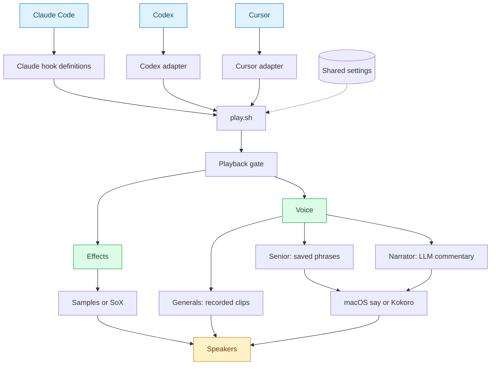
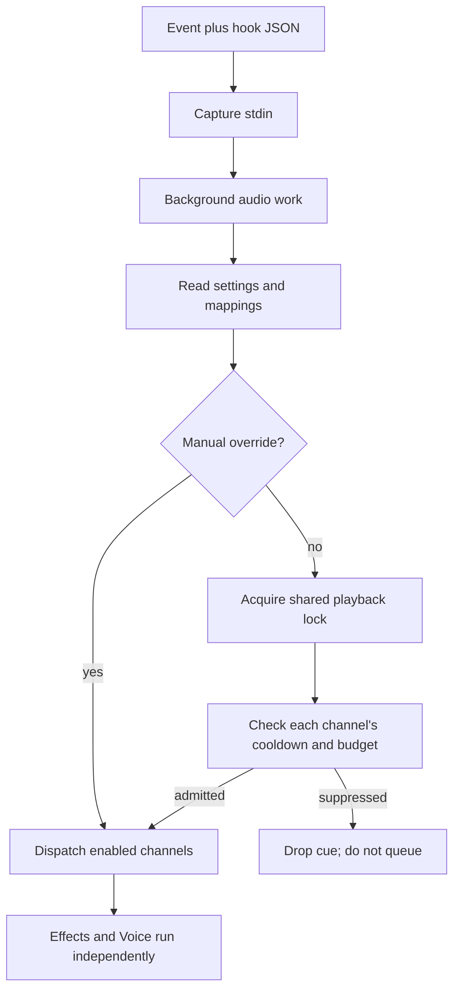
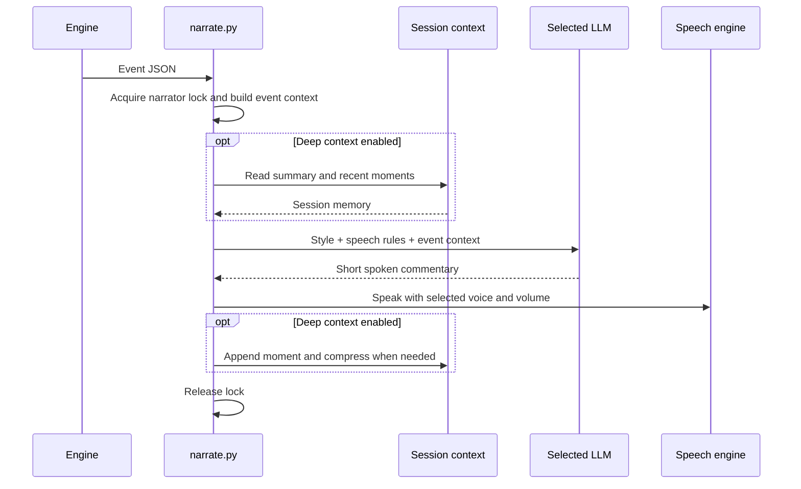
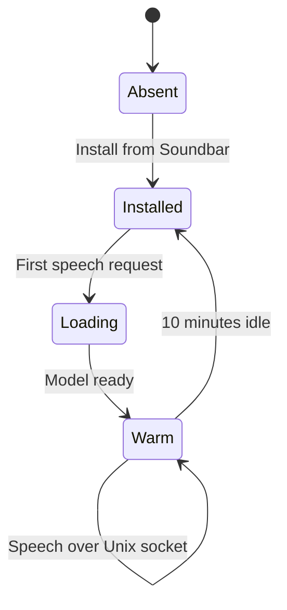
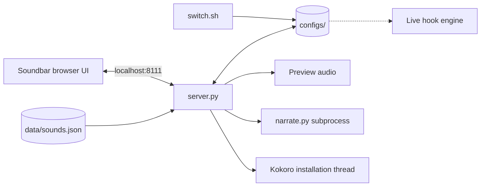
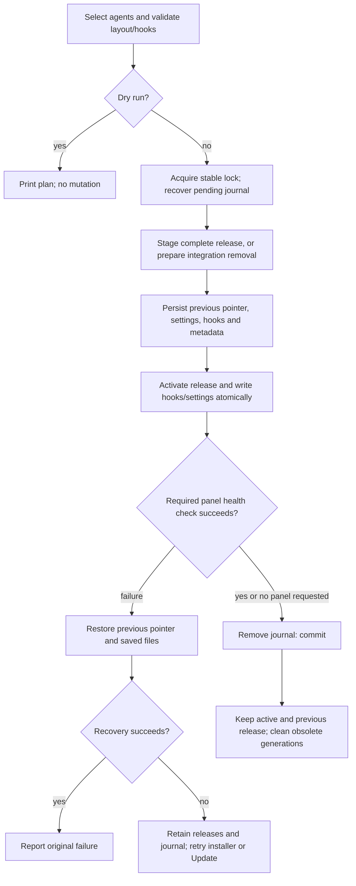
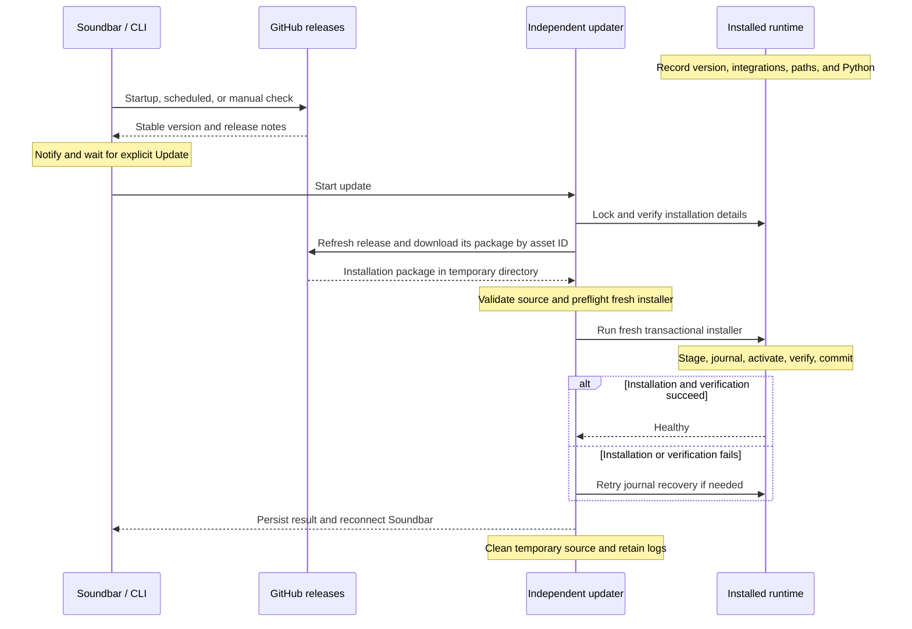

# Code Gossip architecture

A map of the current runtime: **three agent integrations, two audio channels, one shared installation**.

[Runtime](#runtime-at-a-glance) · [Package](#package-map) · [Events](#agent-events) · [Playback](#playback-and-spacing) · [Narrator](#narration-and-speech) · [Soundbar](#soundbar-and-its-api) · [Installation](#installation-and-removal) · [Data](#data-contracts)

For setup and everyday use, see the [installation options](docs/installation.md) and [usage guide](docs/usage.md). For release history, see [CHANGELOG.md](CHANGELOG.md). This document describes implemented behavior.

For the proposed separation of hook observations, activity state, and audio policy, see the [experimental event model design](docs/design/experimental-event-model.md). That design is not implemented.

## Runtime at a glance



**Effects and Voice can play together.** Voice selects one of `senior`, `generals`, or `narrator`. The narrator is inside the Voice channel. Soundbar configures and previews audio; live hooks work without its server running.

## Package map

```text
code-gossip/                         source runtime; see installed layout below
│
├── hooks/                          agent-specific input
│   ├── claude-hooks.json           Claude event → engine command
│   ├── codex.py                    normalize Codex events and tool results
│   └── cursor.py                   normalize Cursor events
│
├── engine/                         shared audio behavior
│   ├── play.sh                     background dispatcher
│   ├── playback_gate.py            cross-process spacing and cooldowns
│   ├── narrate.py                  context → words → speech
│   ├── preview.py                  speech/provider previews from in-memory drafts
│   ├── melody.py                   stateful musical cues shared by hooks and previews
│   ├── model_catalog.py            live provider model discovery
│   ├── kokoro_server.py            warm local speech model
│   └── integrations.py             Python detection and Kokoro installation
│
├── soundbar/                       configuration interface
│   ├── panel.sh / launcher.py      launch/reuse server and open browser
│   ├── server.py                   local HTTP API and previews
│   ├── ui.html / ui.js             category UI and explicit activation
│   └── mockups/                    standalone design explorations
│
├── data/                           shipped content
│   ├── sounds.json                 profile/event manifest
│   └── sounds/                     sampled audio and Generals generator
│
├── configs/                        defaults + gitignored user preferences
├── state/                          gitignored logs, sockets, caches, .venv
├── version_state/                  gitignored installation/update records and recovery
├── VERSION                         generated in release packages; absent from checkouts
├── updates/                        detection, source preparation, installation, recovery
├── update.sh / update.py            installed update CLI
├── paths.py                        shared Python path definitions
├── installer.py                    installation and removal for all agents
├── switch.sh                       command-line controls
└── uninstall.sh                    installed removal entrypoint
```

The repository also contains `install.sh`, an `uninstall.sh` symlink, `test-install.sh`, `tests/`, `docs/` demo assets, and `dev-skills/` for development skills. Normal installation copies only the runtime package into a release generation; development installation symlinks the checkout. Public hook and CLI paths remain under `~/.code-gossip/`.

The Code Gossip homepage is hosted on GitHub Pages. Its reusable [deployment workflow](.github/workflows/pages.yml) deploys the tested `dist/pages/` artifact through the `github-pages` environment after the matching installer is published. It has no separate release-event trigger. Repository **Settings → Pages → Source** must be **GitHub Actions**, and the `github-pages` environment's selected deployment tags must allow stable version tags matching `*.*.*`. These repository settings are separate from the workflow file. Merging changes does not update the public site; publishing a release does.

Python modules resolve package locations through [`paths.py`](code-gossip/paths.py). Shell entrypoints derive the physical release and stable installation roots from their own location. `RUNTIME`, `ENGINE`, `DATA`, and `SOUNDBAR` point into the selected generation; `ROOT`, `CONFIGS`, `STATE`, and `VERSION_STATE` remain outside it. User preferences belong in `configs/`, writable runtime files in `state/`, and relative sound paths resolve against `data/`.

### Website builds and recordings

[`build_pages.py`](scripts/build_pages.py) inserts the current `soundbar/ui.html` markup/styles into the homepage template and copies `ui.js` unchanged. The local server and website build share [`soundbar/catalog.py`](code-gossip/soundbar/catalog.py). The website catalog comes only from `data/sounds.json` and `configs/*.defaults.json`; personal settings, credentials, runtime state, and the local server are never part of the build.

[`docs/demo.js`](docs/demo.js) supplies a static playback adapter to the shared UI. All packs, event variants, phrase alternatives, main/subagent voice choices, and narrator styles can be auditioned. Phrase text is read-only, spoken modes use Kokoro, and provider/setup/save/update controls are omitted from the public demo. Volume and mute affect browser playback. Stop, tab/selection changes, and leaving the page cancel playback. The example session follows five labeled events with the selected pack or voice. `#default`, `#senior`, and `#narrator` still open the corresponding tabs from README links. No API calls, model downloads, speech synthesis, or LLM requests occur in the visitor's browser.

[`render_previews.py`](scripts/render_previews.py) records the exact shipped effects/clip variants and every shipped phrase with each Kokoro voice. It uses a pinned Kokoro model revision at the runtime's default speed, isolated macOS Generals generation, and the runtime's melody composer without changing user settings or melody history. [`demo-commentary.json`](docs/demo-commentary.json) holds explicitly illustrative commentary and provenance for every style. MP3s are content-addressed and reused on regeneration; the manifest records source and audio hashes. Missing, corrupt, uncovered, or stale recordings block the website build.

Wood Thrush composes each browser cue with [`docs/melody.js`](docs/melody.js), using the shipped palette, phrase definitions, weighted choices, and four-note history. History lives in the page, is shared by individual previews and example sessions, and expires after the runtime's two-minute idle interval. Reloading starts fresh; stopping playback or switching packs does not reset the history. Every possible phrase is enumerated from the Python composer and rendered through its actual SoX envelope/reverb into a recording bank. The browser selects that phrase's recording, preserving the local sound without browser synthesis. Build validation requires the complete bank, and Python/JavaScript parity tests compare composition and history behavior to the installed engine.

```bash
# Regenerate only when recording inputs change; requires macOS, FFmpeg, SoX, and Kokoro.
code-gossip/state/.venv/bin/python scripts/render_previews.py
# Build the local demo with a development version label.
python3 -B scripts/build_pages.py
python3 -m http.server 8080 --directory dist/pages
# Test the static site under the actual /code-gossip/ repository subpath.
node tests/test_pages.cjs
# Verify a release website against its installer.
python3 -B scripts/package_release.py 1.2.3
python3 -B scripts/build_pages.py --tag 1.2.3 --package dist/code-gossip.zip
```

The release workflow builds both artifacts from the same checkout and verifies matching UI, catalog, defaults, manifest, bundled source audio, and version. It runs browser tests that decode every recording and exercise actual playback before uploading either artifact. Pages verifies the complete file hashes, source commit/tag, and exact installer digest before deploying the already-tested site. Existing installation assets must be byte-identical on a workflow rerun; deterministic ZIP metadata makes this possible. An older release cannot overwrite the latest release's homepage. Public `build.json` provides the version, commit, runtime source hashes, recording input hashes, and installer digest for auditing. A local **development** build represents its checkout; the public site represents its published release, not personal overrides or unpublished edits.

`docs/assets/` and `docs/render_demo.py` retain the silent README GIF sources and older video renders. They are not included in the Pages artifact.

## Agent events

| Agent | Registration file | Input path | Behavior |
|---|---|---|---|
| Claude Code | `~/.claude/settings.json` | [`hooks/claude-hooks.json`](code-gossip/hooks/claude-hooks.json) → `engine/play.sh` | Explicit lifecycle and tool matchers |
| Codex | `$CODEX_HOME/hooks.json`, default `~/.codex/hooks.json` | [`hooks/codex.py`](code-gossip/hooks/codex.py) → engine | Lifecycle mapping, command classification, result normalization |
| Cursor | `~/.cursor/hooks.json` | [`hooks/cursor.py`](code-gossip/hooks/cursor.py) → engine | Native version-1 user hooks; observational events only |

Adapters discard playback output and make no permission decisions. Generated hook commands check for their entrypoint and tolerate playback failure, so cached hooks can finish quietly after removal. Codex hook trust remains managed by Codex.

### Event vocabulary

The [Soundbar `EVENTS` list](code-gossip/soundbar/server.py) defines 24 categories. Each agent emits a subset; a profile plays only categories it maps.

| Family | Categories |
|---|---|
| Session | `session_start`, `session_end`, `user_prompt`, `stop`, `interrupt` |
| Context and delegation | `pre_compact`, `compact`, `subagent_start`, `subagent_stop` |
| Work | `edit`, `read`, `search`, `plan`, `tool`, `bash`, `test`, `build` |
| Git | `git`, `git_status`, `git_history`, `git_commit`, `git_push` |
| Attention | `permission`, `error` |

A `stop` cue means **the current turn ended**, not that the entire task is complete. Shipped sound profiles reserve ending cues for `stop`/`session_end`; tests, builds, and other work use distinct non-ending cues.

### Routing by agent

| Integration | Routes |
|---|---|
| Claude lifecycle | Session start, prompt submission, stop, post-compaction, subagent start/stop, permission requests |
| Claude tools | Edit/Write and Grep/Glob before execution; Bash after execution; StopFailure and PostToolUseFailure → `error` |
| Codex lifecycle | Startup/resume/clear, session end, prompt, permission, pre/post compaction, subagent start/stop, stop, interrupt |
| Codex tools | Non-shell categories before execution; shell completion and explicit failures afterward |
| Cursor | Session start/end, file edits, completed shell/MCP operations, failures, subagent completion, pre-compaction, stop |

<details>
<summary>Codex command classification and limitations</summary>

Compound commands prioritize push, commit, tests, builds, other Git operations, history, status, search, then reads. The adapter handles shell wrappers and Git global options such as `-C` and `-c`.

- Commit and push cues require an explicit successful exit status. Dry runs use the neutral Git cue.
- For `rg` and `grep`, exit code 1 means no matches; exit code 2 produces an error cue.
- Pending shell sessions are not reported as complete. Polling and coordination tools stay quiet.
- Explicit shell, patch, and MCP failures route to `error`.
- Hosted web searches do not emit local tool hooks. Missing failure indicators cannot reliably produce error cues.
- `codex_permission_sound_on: false` suppresses the entire approval-audio dispatch; it changes no permissions and does not affect other agents or manual previews.

Normalized payloads carry `soundbar_agent` and `soundbar_event` so the narrator can describe the actual agent and event. Cursor shell completion supplies command/output context without inventing an exit code.

</details>

## Playback and spacing



[`play.sh`](code-gossip/engine/play.sh) captures input before backgrounding; hook commands do not add another trailing `&`. It reads settings through `jq`, converts 0–100 volumes without locale-dependent arithmetic, and uses the manifest to dispatch samples or generated effects.

| Gate rule | Current behavior |
|---|---|
| Persistence | `state/playback/lock` and atomically replaced `state.json` |
| Clock | `CLOCK_MONOTONIC`, shared across processes |
| Lock wait | At most 100 ms; a gate error lets audio proceed |
| Repeat defaults | Effects: 750 ms; Voice: 3000 ms; adjustable from 0–10000 ms |
| Repeat identity | Channel, session, profile, and mapped sound; important cues use event identity |
| Burst budget | Shared across sessions per channel; routine spacing capped at 150 ms for Effects and 1500 ms for Voice |
| Important cues | Permission, error, stop, interrupt, Git commit/push bypass the routine budget; duplicate suppression remains |
| Preview | `FORCE_LAYER`, `FORCE_EFFECTS_PROFILE`, or `FORCE_VOICE_PROFILE` bypass the gate |

The gate drops repeated cues; it does not schedule audio or wait for clips to finish. Narration also has a separate overlap lock at `state/narrator.lock`.

## Narration and speech



| Concern | Implementation |
|---|---|
| Providers | Claude CLI, Anthropic, Gemini, OpenAI, Ollama; provider/model defaults live in the source |
| Style | `{label, prompt}` objects in `configs/narrator_styles.json`, falling back to shipped defaults |
| Speech clarity | `build_system_prompt()` appends rules for plain, speakable prose |
| Deep context | Optional per-session summary/recent moments in `state/session_context/` |
| Compression | When recent moments exceed 10, fold older entries into the summary and retain the newest 4 |
| Cleanup | Session files older than 7 days are pruned |
| Privacy boundary | Narrator event context goes to the selected provider; basic effects and fixed phrases need no LLM |

### Kokoro lifecycle



[`integrations.py`](code-gossip/engine/integrations.py) detects a compatible Python, creates `state/.venv`, installs Python dependencies and the spaCy language model, and verifies importability. The Kokoro speech model downloads on first use. Installation progress is held in memory; cached Python discovery and installation flags live in `state/integrations.json`.

The daemon listens on `state/kokoro.sock` with mode `0600`. It caches pipelines per language and serializes inference. `narrate.py` starts it on demand. macOS `say` is the built-in alternative; `senior` and `narrator` both use the selected speech engine. Generals plays generated clips directly.

## Soundbar and its API



`panel.sh` uses `launcher.py` to reuse a ready server or start one, then opens the browser. Manual launches run in the foreground; installation uses `--background` after hook setup, unless `--no-panel` was passed. Reinstallation restarts only the recorded, identity-checked panel process to load updated Python code. Install/update transactions stop the owned Kokoro daemon too; speech starts it again when needed. The launcher checks `/api/health` for the application and resolved runtime path before opening the UI. Startup verification failures roll back the transaction. A browser-opening failure after commit reports a manual-open command without undoing installation. The Python server binds to `127.0.0.1`, writes `state/.server.pid` after binding, and removes its own PID file on shutdown. The **Close Soundbar** button is unavailable during Kokoro installation, with an explanation that closing the browser tab is safe. The server also rejects shutdown during installation. Outside installation it sends a same-origin `POST /api/shutdown`; the server responds before stopping its request loop, closes the socket, and removes its PID file. The UI shows a closed state with reopening instructions. Closing the browser tab alone does not stop the server. Agent hooks and the separate Kokoro process remain active.

`ui.html` and `ui.js` present Effects, Clips, Phrases, and AI commentary in a list and detail workspace. The header shows what is in use, mute, and volume. Each tab is a draft. **Save** (`POST /api/save`) validates and writes that draft without changing the active channels or mode. **Use** and **Save & use** (`POST /api/activate`) write the same way and switch the active channel. The server validates configuration and phrase shapes before writing, atomically replaces each settings file, and restores phrases if the config write fails. `GET /api/status` includes shipped `phrases_defaults` so one event can be reset. The mode is remembered for mute and reload. Combined Effects + Voice stays until an explicit **Use**; the hook dispatcher still supports both channels. Amber and Mint are a browser preference stored as `code-gossip.soundbar-theme`.

`/api/draft-check` and `/api/draft-preview` merge allowed draft keys into a temporary in-memory config. Credentials for a saved provider are never reused for a different provider. `engine/preview.py` receives JSON through stdin using the configured Python executable, without changing config or phrase files. Speech previews use the selected engine, speaker, and exact alternative. Effects and clips expose event/sample identities through `preview_catalog`; draft playback waits for the selected sample to finish. AI sample generation uses the draft provider/model/style and an example edit, returns text without speaking, and replay speaks that text without calling the provider again. These previews bypass live-hook spacing. Kokoro main and subagent voices are configured separately.

The HTTP server handles requests concurrently so slow checks, model discovery, and previews do not block mute or status requests. Settings mutations share the installer lock and configuration files are replaced atomically. Every POST requires an allowed loopback Origin and the Soundbar request header; GET and POST reject non-loopback Host headers. This blocks browser cross-site mutations and DNS rebinding; it is not authentication against other local processes. Setup status derives from manifest files, audio tools, and Kokoro installation progress. Initial status uses lightweight Python/package file inventory; it never imports Kokoro. The separate speech check verifies runtime availability after the UI loads. The install endpoint verifies imports rather than trusting a saved installed flag, with a 30-second process-local cache. Missing Python invalidates that cache immediately. Installation has a single guarded worker, keeps the process alive until completion, and offers explicit repair after a failed speech check; repairing an existing environment reinstalls its packages.

Provider and speech checks validate only their own settings and have separate scopes and UI results. Installation and verification occupy separate rows in the speech drawer, with progress and error details below. **Use** and **Save & use** stay disabled while setup is incomplete, with a reason and a drawer link. **Save** can keep an inactive draft before setup is complete; saves affecting active effects or shared speech settings require local playback readiness. Phrases and AI keep separate engine drafts, and saving rebases untouched shared speech fields in the other tab while preserving its edits. Saving marks the button busy and announces “Saving selection…” without switching playback early. Verification appears only once dependencies are available; installation success does not imply verification. Local checks return to **Check** after **Checking…**; cloud and Ollama checks use **Check connection** / **Connecting…**, while Claude CLI uses **Check CLI** / **Checking…**. Results name what was verified: audio files, the speech engine, the CLI executable, the Ollama server, or a cloud connection. Green means success, orange pending or action needed, red failure, and gray built-in availability. The strip and the drawer show the same result. Phrases and AI commentary share one speech drawer.

Reloading resumes installation polling through `/api/setup`, without invoking Python discovery or installation. Effects, clips, phrase speech, and free AI providers (Claude CLI and Ollama) are checked for the visible tab on load, first visit, relevant draft changes, and installation completion. Cloud providers are never checked automatically, including after reload, because a connection check can be billed. Results are scoped to the checked settings; unchanged style edits and repeat tab visits do not recheck. Reloading revalidates local availability without saving drafts or installing anything. Failed checks remain available for manual retry. Installation requires an explicit action. Global sound, volume, and repeat preferences save independently of the draft. Request failures leave the active snapshot intact.

**?** opens a Getting started list: modes, auditioning, phrases, the AI provider, save and use, and settings. Choosing a topic closes the list and jumps to that part of the panel. It does not save, play, install, or run a check.

Model suggestions come from `/api/narrator-models`, which reads the draft provider and key without saving them. [`engine/model_catalog.py`](code-gossip/engine/model_catalog.py) calls the [Anthropic](https://platform.claude.com/docs/en/api/models/list), [Gemini](https://ai.google.dev/api/models), [OpenAI](https://developers.openai.com/api/reference/resources/models/methods/list), or [Ollama](https://docs.ollama.com/api/tags) catalog; it follows pagination where supported and excludes known non-language models from cloud suggestions. Catalog membership does not guarantee narration compatibility. Cloud connection checks make a small generation request; CLI checks detect the executable and Ollama checks server reachability. **Play sample** generates and plays narration when needed; subsequent clicks replay the displayed text. This tests actual narration with the selected model. Ollama lists locally installed models. Claude CLI has no supported catalog integration, so manual entry/default remains available without fixed suggestions. Opening provider setup, switching providers, or finishing a key edit loads suggestions; refresh is also explicit. Failures clear suggestions, stale responses are ignored, and discovery never replaces the selected model or generates text.

<details>
<summary>HTTP endpoint reference</summary>

| Method | Endpoint | Purpose |
|---|---|---|
| GET | `/`, `/ui`, `/ui.js` | Soundbar interface |
| GET | `/api/setup` | Manifest audio and speech dependency availability |
| POST | `/api/activate` | Validate, save, and switch to a selected mode and its draft settings/phrases |
| POST | `/api/save` | Validate and save that draft without changing the active channels or mode |
| POST | `/api/draft-check`, `/api/draft-preview` | Check or preview unsaved selections without config writes |
| POST | `/api/narrator-models` | Read available models with the draft provider credentials; no config writes |
| GET | `/api/health` | Panel identity, resolved runtime path, and version loaded at startup |
| GET | `/api/updates` | Cached release information and persistent update progress/result |
| POST | `/api/update-check` | Same-origin UI request for an immediate release check |
| POST | `/api/update` | Same-origin UI request to start the independent updater |
| POST | `/api/shutdown` | Same-origin UI request to stop the panel and clean up its PID file |
| GET | `/api/status` | Settings, profiles, events, voices, provider metadata, and shipped phrase defaults |
| POST | `/api/config` | Save recognized settings keys |
| POST | `/api/phrases` | Save phrases for an event |
| POST | `/api/play` | Preview a profile/event |
| POST | `/api/say` | Preview a voice/phrase |
| POST | `/api/tts-check` | Check the selected speech engine |
| POST | `/api/kokoro-install` | Start background installation |
| POST | `/api/kokoro-status` | Read installation progress/status |
| POST | `/api/narrator-style` | Create, update, or rename a style |
| POST | `/api/narrator-style-delete` | Delete a style |
| POST | `/api/narrator-style-reset` | Restore shipped styles |
| POST | `/api/narrator-check` | Check provider connectivity |
| POST | `/api/narrator-test` | Generate and speak test commentary |

The endpoint definitions and request fields live in [`server.py`](code-gossip/soundbar/server.py). Responses are JSON except for the UI routes.

</details>

## Installation and removal



A normal install uses complete release generations and a single atomic `current` switch, following the [generation pattern used by Nix](https://nix.dev/manual/nix/2.24/package-management/profiles). [`os.replace()`](https://docs.python.org/3/library/os.html#os.replace) changes the symlink on the same filesystem. Release files, atomic JSON replacements, and the journal are flushed before commit. The journal follows the [rollback-journal principle](https://www.sqlite.org/atomiccommit.html): save what recovery needs before mutating it, and retain that information until verification succeeds.

```text
~/.code-gossip.lock                  stable install/update/settings lock; survives removal
~/.code-gossip/
├── current -> version_state/releases/<generation>
├── hooks, engine, soundbar, data, updates -> current/<name>
├── installer.py, paths.py, update.*, switch.sh, uninstall.sh, VERSION -> current/<name>
├── configs/                        user JSON; defaults link into current/configs/
├── state/                          logs, caches, Kokoro environment and sockets
└── version_state/
    ├── releases/<generation>/      complete runtime copies; active and previous retained
    ├── transaction.json            private recovery journal, present until commit
    └── installation.json, check.json, operation.json, update.log, check.lock
```

| Contract | Behavior |
|---|---|
| Detection / selection | CLI executables, agent config directories and macOS applications; names, menu numbers, or `--agents`/`--all` |
| Validation | Install checks selected hook documents; uninstall checks all supported documents before deciding whether the runtime is unused. Unexpected runtime links and symlinked installation directories are rejected. |
| Preparation | Copy a fresh release without local settings/state, generate Generals clips when `say` exists, preserve [referenced custom audio](#sound-manifest), and flush the copy. Preparation failure leaves the active release untouched. |
| Merge | Remove only Code Gossip handlers, including those in shared groups; preserve unrelated JSON. Reread after preparation and reject a detected concurrent hook edit. |
| Journal | Save raw settings, hook documents/backups, installation metadata, previous release pointer and panel state before mutation. Atomic writes never truncate the live JSON file. |
| Verify | Restart and verify root/version when installing with a panel, replacing a running panel, or updating. `--no-panel` skips startup when the panel was already stopped. |
| Recovery | Restore the pointer and saved files; merge our old handlers into externally changed hook documents. A failed recovery retains executable releases and the journal; retry before further mutations. Fresh-install recovery may require rerunning the downloaded installer. |
| Backup / retention | Changed hook documents retain `.code-gossip-backup`; successful normal installs keep active and previous generations. Replacing the generation removes obsolete code from active paths. |
| Dev install | `~/.code-gossip` links to the checkout's `code-gossip/`; settings and state stay there. The journal protects settings/hooks, but cannot roll back edits already made to checkout code. |
| Removal | Commit hook removal first. Keep the shared runtime/processes while integrations remain; otherwise stop owned processes and remove files without traversing directory symlinks. Keep user settings unless `--purge`. A cleanup failure can leave unused files to remove on retry. |
| Dev removal | Remove only the installation symlink, never checkout content, even with `--purge` |

Custom Codex homes require the same `CODEX_HOME` for installation and removal. A normal installation and a dev symlink cannot overwrite each other. Flat normal installations are rejected before mutation and require the [explicit uninstall/reinstall procedure](docs/updates.md#existing-flat-installations); no automatic migration is attempted. External tools that edit agent JSON do not share this lock, so simultaneous edits should be avoided.

### Release updates

Normal installs and updates consume the same `code-gossip.zip` release asset. The [release workflow](.github/workflows/release.yml) starts when a GitHub release is published, checks out its tagged commit, and runs [`package_release.py`](scripts/package_release.py). The builder includes tracked runtime files, preserves executable modes, uses deterministic ZIP timestamps, and generates `VERSION` from the tag inside the ZIP. It never changes the checkout. The workflow tests that exact package and matching website, uploads the package to the already-published release, and then deploys the tested Pages artifact. A rerun requires an existing installation package to be identical before proceeding. Creating or pushing a tag alone does not publish anything; PRs run the same checks without publication. Pushes to `main`, including merged PRs, do not trigger another run. The release asset becomes available after the workflow succeeds. `VERSION` is generated metadata, not a source-controlled version number.

The standalone [`docs/install.sh`](docs/install.sh) bootstrap is served by Pages. It checks macOS and prerequisites, downloads the requested installation ZIP to a temporary directory, rejects unsafe archive paths/types and excessive sizes, forwards arguments to its installer, and cleans up on success or failure. It rejects development mode, which must use a permanent checkout. Release homepages pass `--release <tag>` so a cached page installs the version it demonstrates. The bootstrap validates the downloaded VERSION before running the installer; invocations without `--release` still use the latest release. Installation behavior and saved settings remain owned by the existing installer.

Soundbar and [`update.sh`](code-gossip/update.sh) share the [`updates`](code-gossip/updates/) public operations. A normal install from a checkout uses [`install_latest()`](code-gossip/installer.py) to download and validate the package before invoking its installer; an extracted package installs directly. Both downloads use [`fetch_source()`](code-gossip/updates/source.py). Development installs bypass release downloads, keep their symlinks, report `development`, and receive checkout-based update instructions. Older flat installations require the explicit reinstall described above.



| Step / owner | Contract |
|---|---|
| Record — `updates/storage.py`, installer | Record the release version, normal/dev mode, Python, and selected integration configuration paths in `version_state/installation.json`; partial install/removal updates the selection. A recorded custom Codex home is passed to the fresh installer even if Soundbar lacks that environment variable. |
| Trigger and detect — `updates/check.py` | A server-owned background thread checks the cache on startup and hourly, contacting GitHub only after 24 hours since success. Failed automatic attempts retry at most hourly. The Soundbar button and `update.sh check` bypass the cache. No hook or separate background service checks for releases. |
| Discover and notify — `updates/github.py`, Soundbar | Use GitHub's [latest stable release API](https://docs.github.com/en/rest/releases/releases#get-the-latest-release); compare numeric major/minor/patch versions, accepting an optional `v`. Short network timeouts and cached results keep automatic failures quiet. Manual errors appear beside the check action. Checking never installs. |
| Prepare and fetch — `updates/update.py`, `source.py` | An explicit update refreshes release information, validates recorded integrations/Python, and downloads the uploaded `code-gossip.zip` by its asset ID into an owned OS temporary directory. Missing/incomplete assets are rejected without falling back to source archives. Reject traversal, unexpected symlinks, special files, oversized archives, missing runtime files, and mismatched versions. Run the downloaded installer's dry run before changing runtime files. |
| Install — `updates/process.py`, `installation.py`, fresh installer | A detached worker survives the panel/terminal closing and holds a process lock inherited by its installer. Settings mutations, another install/update, and new Kokoro installations are blocked during the transaction; an already running Kokoro installation prevents updating. Invoke the fresh transactional installer with the recorded interpreter and existing integration selection. The same journal and activation code handles direct installation and updates. |
| Verify or recover — `updates/soundbar.py`, `recovery.py` | Restart only the identity-checked Soundbar process and verify its root and startup version through `/api/health`. Preserve `state/` and `version_state/` throughout. On failure, restore the previous runtime and our hook handlers, preserving unrelated hook edits. Failed recovery retains the journal and previous generation. A later Update or installer run retries recovery before proceeding. |
| Report and clean — `updates/storage.py`, `source.py`, Soundbar | Persist progress, result, and log; reconnect and reload the UI after a successful version change. Hook guidance depends on changed owned definitions, ignoring mere ordering. Delete temporary source after completion/failure; clean only directories with this installation's ownership marker. Keep recovery data if recovery still needs attention. |

[`run_update()`](code-gossip/updates/update.py) recovers pending work, downloads and preflights the package, invokes its installer, persists the result, and returns a CLI exit code. [`fetch_source()`](code-gossip/updates/source.py) owns download/extraction validation; [`installer.run()`](code-gossip/installer.py) owns mutations; [`recover()`](code-gossip/updates/recovery.py) restores a pending journal. There is no separate updater backup/copy path.

| Supporting module | Responsibility |
|---|---|
| [`entities.py`](code-gossip/updates/entities.py) | Typed versions, releases, installations, check results, progress, and status exchanged between steps |
| [`config.py`](code-gossip/updates/config.py) | Check intervals, timeouts, archive limits, and paths resolved from the selected runtime |
| [`constants.py`](code-gossip/updates/constants.py) | Repository identity, filenames and required source files |
| [`storage.py`](code-gossip/updates/storage.py) | Atomic JSON persistence and conversion between saved records and typed entities |
| [`errors.py`](code-gossip/updates/errors.py) | Explicit update and busy errors |
| [`cli.py`](code-gossip/updates/cli.py), [`__init__.py`](code-gossip/updates/__init__.py) | CLI argument/output handling and Soundbar-facing operations; JSON payloads stay at these boundaries and storage |

The CLI supports `check`, `update`, and `status`, with `--json` for machine-readable results. Local records, release generations and the journal are excluded from source copies and Git. Downloads use owned temporary directories; the installed runtime has no Git repository. `GET /api/updates` only reads status. Automatic checks continue until the Soundbar server stops.

Packages are trusted code delivered over HTTPS from this repository’s GitHub releases. Archive validation prevents extraction escapes and rejects malformed packages; it does not provide independent release signatures or protect against a compromised publisher. Recovery is tested across process termination and injected write/health failures, not physical disk loss. If both retained releases are damaged, reinstall from a fresh package.

## Data contracts

### Files and ownership

| Location under `~/.code-gossip/` | Role | Owner |
|---|---|---|
| `configs/*.defaults.json` | Shipped settings, phrases, and styles | Repository |
| `configs/config.json` | Channel preferences, TTS, narrator settings, API key | User; Soundbar/CLI |
| `configs/phrases.json` | Senior phrases by event | User; Soundbar/API |
| `configs/narrator_styles.json` | Narrator labels and prompts | User; Soundbar/API |
| `configs/sounds.json` | Optional full manifest override | User; [sound-design skill](dev-skills/sound-design/SKILL.md)/manual edits |
| `data/sounds.json` | Shipped effects and recorded-voice mappings | Repository |
| `data/sounds/` | Audio assets and Generals generator | Shipped samples; generated/custom files |
| `state/integrations.json` | Optional-engine installation metadata | Integration manager |
| `state/.venv/` | Kokoro dependencies | Integration manager |
| `state/` logs, sockets, locks, session files | Runtime coordination and diagnostics | Runtime processes |

User settings and runtime state are gitignored. API keys saved through Soundbar are stored in `configs/config.json`. Read [`config.defaults.json`](code-gossip/configs/config.defaults.json) for current defaults instead of duplicating them here.

### Sound manifest

The optional `configs/sounds.json` **replaces the shipped manifest as a whole**. Start a custom manifest by copying `data/sounds.json`; retain unrelated profiles. The server chooses its manifest path at startup, so restart Soundbar after creating an override for the first time.

```json
{
  "effects": {
    "custom": {
      "dir": "sounds/custom",
      "events": {
        "edit": {"files": ["pencil-a.mp3", "pencil-b.mp3"], "rate": [0.95, 1.05]},
        "permission": {"file": "bell.mp3"},
        "stop": {"sequence": [["page.mp3", "close.mp3"]], "gap": 0.2}
      }
    }
  },
  "voice": {}
}
```

This illustrates the schema; copy the full shipped manifest when creating an override.

| Mapping | Dispatch |
|---|---|
| `file` | One sample through `afplay` |
| `files` | Random sample from a list |
| `sequence` | Random choice of a sequence; play its files in order with `gap` seconds between |
| `sox` | Generated sound through `play -qn`, with the channel volume applied |
| `melody` | Stateful musical phrase through `engine/melody.py` and SoX; uses the profile's `melody` palette |
| `rate: [min, max]` | Optional randomized playback rate for file-based mappings |

Relative file names combine with the profile's `dir` under `data/`; absolute paths stay absolute. Manifest arguments and paths are trusted local configuration. Keep custom sound specs under your control.

Normal reinstalls and updates preserve registered audio while staging each release:

```text
configs/sounds.json ── file / files / sequence ──> referenced samples
old release/data/sounds/custom/local.wav ──copy──> staged release/data/sounds/custom/local.wav
                                                verify + flush → activate
```

| Referenced sample | Preparation rule |
|---|---|
| Shipped by both old and new releases | Use the new package, including when the old sample was edited locally |
| Absent from the new package | Copy from the active release; this also retains retired shipped samples still referenced by the override |
| Custom path now occupied by the new package | Accept identical bytes; otherwise abort and ask the user to rename the custom sample |
| Missing custom source, traversal, or a symlink escaping `data/sounds/` | Abort before activation; the active release stays intact |
| Absolute path outside the installation | Leave the external file and reference untouched |
| Absolute path through `~/.code-gossip/data/` | Preserve as above; references to individual release generations are rejected |
| File absent from the override manifest | Do not carry it forward; only the new package supplies it |

Use distinct custom filenames under `data/sounds/`. A missing old shipped sample may remain absent (for example, Generals clips on a system without `say`). Preservation repeats on every install/update, without version checks, path migration, or rewriting the override. A fresh install with retained settings has no previous runtime to copy; restore backed-up custom samples after installing. Full uninstall removes audio even without `--purge`; see the [manual reinstall steps](docs/updates.md#existing-flat-installations).


Wood Thrush (`wood-thrush`) uses a C minor pentatonic palette from C3 to C5. Its profile-level `melody` defines a MIDI `root`, semitone `scale` offsets, and an inclusive MIDI `range`. Each event's `melody` supplies a `phrase` (`note`, `rise`, `fall`, `question`, or `resolve`) and the sine envelope: total `duration`, `gain`, `attack`, `release`, and `reverb`. The weighted walk favors nearby scale notes, avoids immediate repeats, reduces recent-note reuse, and favors reversing direction after a leap. Attention cues repeat a pitch; completion alone uses a fifth-to-tonic resolution. The new profile uses Submarine-inspired volumes, cue lengths, fades, and reverb. Submarine retains its original fixed tones and glides.

[`melody.py`](code-gossip/engine/melody.py) keeps the last four notes per channel/profile/palette in `state/melody/state.json`, shared across hook processes under a bounded file lock and replaced atomically. History expires after two minutes of silence. Soundbar and forced command-line previews share a separate history. State failures fall back to a fresh phrase, and the hook remains backgrounded. Both playback paths use the configured Python and resolve SoX through `paths.executable`.

### Phrases and styles

| Data | Shape |
|---|---|
| Ordinary senior phrases | `"edit": ["Writing code", "Making a change"]` |
| Subagent dialogue | `"subagent_start": [["Check this", "On it"]]` |
| Narrator style | `"pair_programmer": {"label": "Pair Programmer", "prompt": "..."}` |

Missing senior events can use shipped phrases; an explicitly empty event array stays silent. Effects and Generals mappings have no sound when an event is unmapped.

## Dependencies and verification

| Layer | Dependencies |
|---|---|
| Core hooks, Soundbar, installer | Bash, Python 3 standard library, `jq` |
| macOS playback and speech | `afplay`, `say` |
| Generated effects | Optional SoX (`play`) |
| Neural speech | Optional Kokoro environment managed separately in `state/.venv` |
| Tests | `pytest`; Codex adapter unit tests also run with `unittest` |

The project currently targets macOS. See [contributor guide](AGENTS.md#validation) for test commands. Installer tests use isolated homes and cover selection, preservation of unrelated hooks, partial removal, dev mode, and cached hooks after uninstall.
