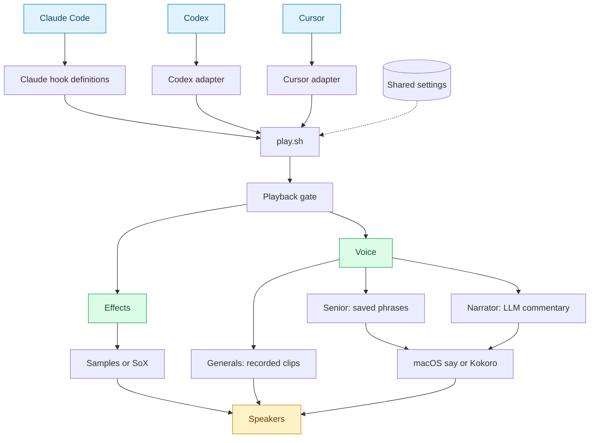
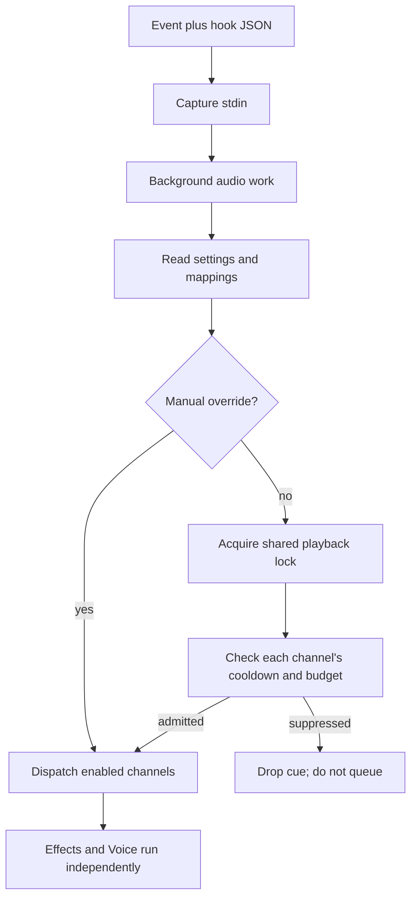
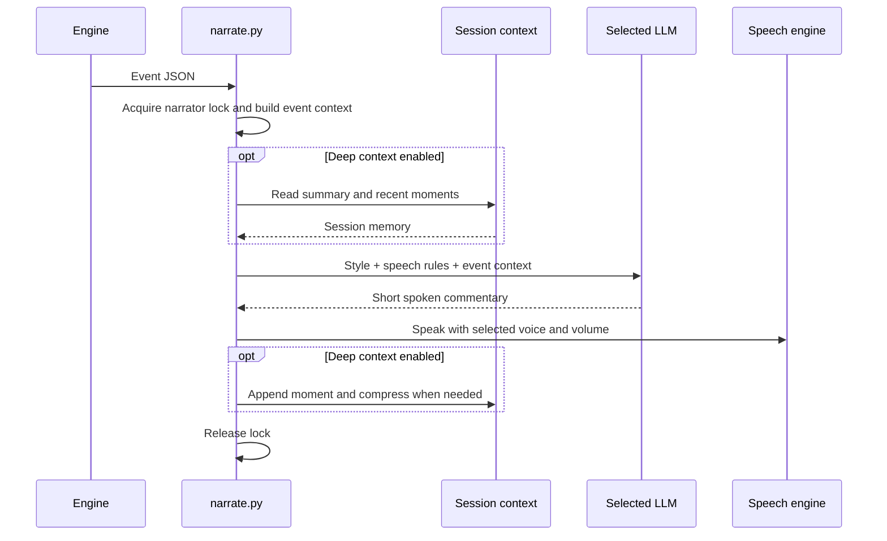
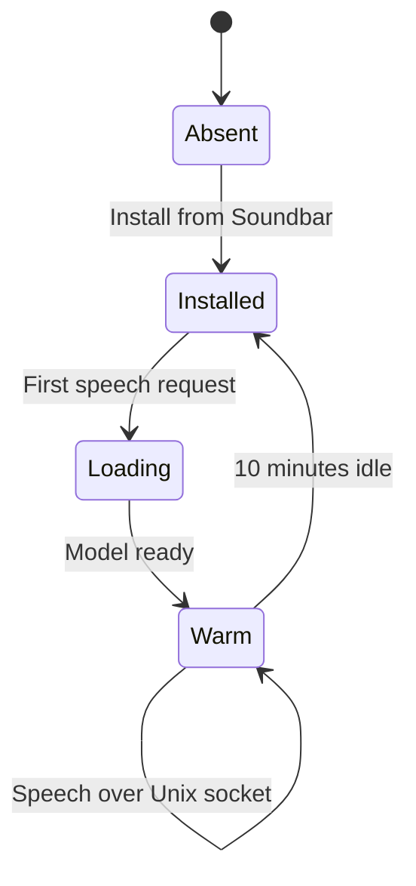
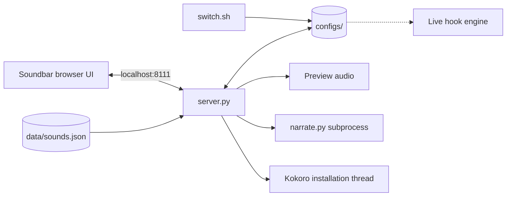
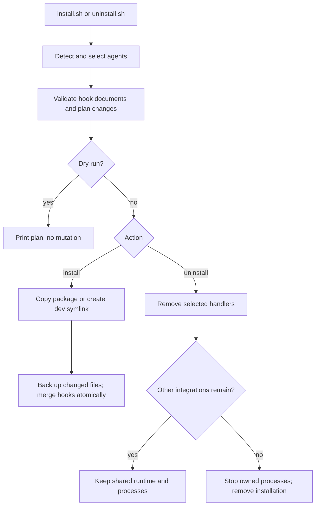

# Code Gossip architecture

A map of the current runtime: **three agent integrations, two audio channels, one shared installation**.

[Runtime](#runtime-at-a-glance) · [Package](#package-map) · [Events](#agent-events) · [Playback](#playback-and-spacing) · [Narrator](#narration-and-speech) · [Soundbar](#soundbar-and-its-api) · [Installation](#installation-and-removal) · [Data](#data-contracts)

For setup and everyday use, see the [usage guide](README.md#using-code-gossip). For release history, see [CHANGELOG.md](CHANGELOG.md). This document describes implemented behavior.

## Runtime at a glance



**Effects and Voice can play together.** Voice selects one of `senior`, `generals`, or `narrator`. The narrator is inside the Voice channel. Soundbar configures and previews audio; live hooks work without its server running.

## Package map

```text
code-gossip/                         installed as ~/.code-gossip/
│
├── hooks/                          agent-specific input
│   ├── claude-hooks.json           Claude event → engine command
│   ├── codex.py                    normalize Codex events and tool results
│   └── cursor.py                   normalize Cursor events
│
├── engine/                         shared audio behavior
│   ├── play.sh                     background dispatcher
│   ├── playback_gate.py            cross-process spacing and cooldowns
│   ├── narrate.py                  context → words → speech
│   ├── preview.py                  speech/provider previews from in-memory drafts
│   ├── kokoro_server.py            warm local speech model
│   └── integrations.py             Python detection and Kokoro installation
│
├── soundbar/                       configuration interface
│   ├── panel.sh / launcher.py      launch/reuse server and open browser
│   ├── server.py                   local HTTP API and previews
│   ├── ui.html / ui.js             category UI and explicit activation
│   └── mockups/                    standalone design explorations
│
├── data/                           shipped content
│   ├── sounds.json                 profile/event manifest
│   └── sounds/                     sampled audio and Generals generator
│
├── configs/                        defaults + gitignored user preferences
├── state/                          gitignored logs, sockets, caches, .venv
├── paths.py                        shared Python path definitions
├── installer.py                    installation and removal for all agents
├── switch.sh                       command-line controls
└── uninstall.sh                    installed removal entrypoint
```

The repository also contains `install.sh`, an `uninstall.sh` symlink, `test-install.sh`, `tests/`, `docs/` demo assets, and `dev-skills/` for development skills. Normal installation copies only the runtime package; development installation symlinks it. GitHub Pages publishes `docs/` from `main`: `index.html`, `player.css`, and `player.js` present the demo media in `docs/assets/`. Playback is local to the visitor’s browser and independent of the installed Soundbar.

Python modules resolve package locations through [`paths.py`](code-gossip/paths.py). Shell entrypoints derive their package root from their own location. User preferences belong in `configs/`, writable runtime files in `state/`, and relative sound paths resolve against `data/`.

## Agent events

| Agent | Registration file | Input path | Behavior |
|---|---|---|---|
| Claude Code | `~/.claude/settings.json` | [`hooks/claude-hooks.json`](code-gossip/hooks/claude-hooks.json) → `engine/play.sh` | Explicit lifecycle and tool matchers |
| Codex | `$CODEX_HOME/hooks.json`, default `~/.codex/hooks.json` | [`hooks/codex.py`](code-gossip/hooks/codex.py) → engine | Lifecycle mapping, command classification, result normalization |
| Cursor | `~/.cursor/hooks.json` | [`hooks/cursor.py`](code-gossip/hooks/cursor.py) → engine | Native version-1 user hooks; observational events only |

Adapters discard playback output and make no permission decisions. Generated hook commands check for their entrypoint and tolerate playback failure, so cached hooks can finish quietly after removal. Codex hook trust remains managed by Codex.

### Event vocabulary

The [Soundbar `EVENTS` list](code-gossip/soundbar/server.py) defines 24 categories. Each agent emits a subset; a profile plays only categories it maps.

| Family | Categories |
|---|---|
| Session | `session_start`, `session_end`, `user_prompt`, `stop`, `interrupt` |
| Context and delegation | `pre_compact`, `compact`, `subagent_start`, `subagent_stop` |
| Work | `edit`, `read`, `search`, `plan`, `tool`, `bash`, `test`, `build` |
| Git | `git`, `git_status`, `git_history`, `git_commit`, `git_push` |
| Attention | `permission`, `error` |

A `stop` cue means **the current turn ended**, not that the entire task is complete. Shipped sound profiles reserve ending cues for `stop`/`session_end`; tests, builds, and other work use distinct non-ending cues.

### Routing by agent

| Integration | Routes |
|---|---|
| Claude lifecycle | Session start, prompt submission, stop, post-compaction, subagent start/stop, permission requests |
| Claude tools | Edit/Write and Grep/Glob before execution; Bash after execution; StopFailure and PostToolUseFailure → `error` |
| Codex lifecycle | Startup/resume/clear, session end, prompt, permission, pre/post compaction, subagent start/stop, stop, interrupt |
| Codex tools | Non-shell categories before execution; shell completion and explicit failures afterward |
| Cursor | Session start/end, file edits, completed shell/MCP operations, failures, subagent completion, pre-compaction, stop |

<details>
<summary>Codex command classification and limitations</summary>

Compound commands prioritize push, commit, tests, builds, other Git operations, history, status, search, then reads. The adapter handles shell wrappers and Git global options such as `-C` and `-c`.

- Commit and push cues require an explicit successful exit status. Dry runs use the neutral Git cue.
- For `rg` and `grep`, exit code 1 means no matches; exit code 2 produces an error cue.
- Pending shell sessions are not reported as complete. Polling and coordination tools stay quiet.
- Explicit shell, patch, and MCP failures route to `error`.
- Hosted web searches do not emit local tool hooks. Missing failure indicators cannot reliably produce error cues.
- `codex_permission_sound_on: false` suppresses the entire approval-audio dispatch; it changes no permissions and does not affect other agents or manual previews.

Normalized payloads carry `soundbar_agent` and `soundbar_event` so the narrator can describe the actual agent and event. Cursor shell completion supplies command/output context without inventing an exit code.

</details>

## Playback and spacing



[`play.sh`](code-gossip/engine/play.sh) captures input before backgrounding; hook commands do not add another trailing `&`. It reads settings through `jq`, converts 0–100 volumes without locale-dependent arithmetic, and uses the manifest to dispatch samples or generated effects.

| Gate rule | Current behavior |
|---|---|
| Persistence | `state/playback/lock` and atomically replaced `state.json` |
| Clock | `CLOCK_MONOTONIC`, shared across processes |
| Lock wait | At most 100 ms; a gate error lets audio proceed |
| Repeat defaults | Effects: 750 ms; Voice: 3000 ms; adjustable from 0–10000 ms |
| Repeat identity | Channel, session, profile, and mapped sound; important cues use event identity |
| Burst budget | Shared across sessions per channel; routine spacing capped at 150 ms for Effects and 1500 ms for Voice |
| Important cues | Permission, error, stop, interrupt, Git commit/push bypass the routine budget; duplicate suppression remains |
| Preview | `FORCE_LAYER`, `FORCE_EFFECTS_PROFILE`, or `FORCE_VOICE_PROFILE` bypass the gate |

The gate drops repeated cues; it does not schedule audio or wait for clips to finish. Narration also has a separate overlap lock at `state/narrator.lock`.

## Narration and speech



| Concern | Implementation |
|---|---|
| Providers | Claude CLI, Anthropic, Gemini, OpenAI, Ollama; provider/model defaults live in the source |
| Style | `{label, prompt}` objects in `configs/narrator_styles.json`, falling back to shipped defaults |
| Speech clarity | `build_system_prompt()` appends rules for plain, speakable prose |
| Deep context | Optional per-session summary/recent moments in `state/session_context/` |
| Compression | When recent moments exceed 10, fold older entries into the summary and retain the newest 4 |
| Cleanup | Session files older than 7 days are pruned |
| Privacy boundary | Narrator event context goes to the selected provider; basic effects and fixed phrases need no LLM |

### Kokoro lifecycle



[`integrations.py`](code-gossip/engine/integrations.py) detects a compatible Python, creates `state/.venv`, installs dependencies and the language model, and verifies importability. Installation progress is held in memory; cached Python discovery and installation flags live in `state/integrations.json`.

The daemon listens on `state/kokoro.sock` with mode `0600`. It caches pipelines per language and serializes inference. `narrate.py` starts it on demand. macOS `say` is the built-in alternative; `senior` and `narrator` both use the selected speech engine. Generals plays generated clips directly.

## Soundbar and its API



`panel.sh` uses `launcher.py` to reuse a ready server or start one, then opens the browser. Manual launches run in the foreground; installation uses `--background` after hook setup, unless `--no-panel` was passed. Reinstallation restarts only the recorded, identity-checked panel process to load updated Python code. The launcher checks `/api/health` for the application and resolved runtime path before opening the UI. Startup/browser failures report a manual-open command without undoing installation. The Python server binds to `127.0.0.1`, writes `state/.server.pid` after binding, and removes its own PID file on shutdown. The **CLOSE SOUNDBAR** button sends a same-origin `POST /api/shutdown`; the server responds before stopping its request loop, closes the socket, and removes its PID file. The UI shows a closed state with reopening instructions. Closing the browser tab alone does not stop the server. Agent hooks and the separate Kokoro process remain active.

`ui.html` and `ui.js` present Effects, Clips, Phrases, and AI commentary. The selected tab is a draft; a separate snapshot identifies active audio. Only **Use** / **Apply changes** commits a draft through `/api/activate`. The server validates configuration and phrase shapes before writing, atomically replaces each settings file, and restores phrases if the config write fails. The mode is remembered for mute/reload. Existing combined channel settings are displayed and preserved until explicit activation; the hook dispatcher still supports both channels.

`/api/draft-check` and `/api/draft-preview` merge allowed draft keys into a temporary in-memory config. Credentials for a saved provider are never reused for a different provider. `engine/preview.py` receives JSON through stdin using the configured Python executable, without changing config or phrase files. Speech previews use the selected engine, speaker, and exact alternative. Effects and clips expose event/sample identities through `preview_catalog`; draft playback waits for the selected sample to finish. AI sample generation uses the draft provider/model/style and an example edit, returns text without speaking, and replay speaks that text without calling the provider again. These previews bypass live-hook spacing. Kokoro main and subagent voices are configured separately.

Setup status derives from manifest files, audio tools, and Kokoro installation progress. Provider and speech checks have separate scopes and UI results. Both speech sections use one template. Reloading resumes installation polling through `/api/setup`, without invoking Python discovery or installation. Provider checks and installation require explicit actions. Global sound, volume, and repeat preferences save independently of the draft. Request failures leave the active snapshot intact. The Help dialog replaces the old first-visit tours.

<details>
<summary>HTTP endpoint reference</summary>

| Method | Endpoint | Purpose |
|---|---|---|
| GET | `/`, `/ui`, `/ui.js` | Soundbar interface |
| GET | `/api/setup` | Manifest audio and speech dependency availability |
| POST | `/api/activate` | Validate and save a selected mode and its draft settings/phrases |
| POST | `/api/draft-check`, `/api/draft-preview` | Check or preview unsaved selections without config writes |
| GET | `/api/health` | Panel identity and resolved runtime path |
| POST | `/api/shutdown` | Same-origin UI request to stop the panel and clean up its PID file |
| GET | `/api/status` | Settings, profiles, events, voices, and provider metadata |
| POST | `/api/config` | Save recognized settings keys |
| POST | `/api/phrases` | Save phrases for an event |
| POST | `/api/play` | Preview a profile/event |
| POST | `/api/say` | Preview a voice/phrase |
| POST | `/api/tts-check` | Check the selected speech engine |
| POST | `/api/kokoro-install` | Start background installation |
| POST | `/api/kokoro-status` | Read installation progress/status |
| POST | `/api/narrator-style` | Create, update, or rename a style |
| POST | `/api/narrator-style-delete` | Delete a style |
| POST | `/api/narrator-style-reset` | Restore shipped styles |
| POST | `/api/narrator-check` | Check provider connectivity |
| POST | `/api/narrator-test` | Generate and speak test commentary |

The endpoint definitions and request fields live in [`server.py`](code-gossip/soundbar/server.py). Responses are JSON except for the UI routes.

</details>

## Installation and removal



| Contract | Behavior |
|---|---|
| Detection | CLI executables, agent config directories, macOS application bundles |
| Selection | All, names, or menu numbers; multiple selections accepted |
| Automation | `--agents` skips selection; install `--all` means detected agents; uninstall `--all` means every supported integration |
| Validation | Install checks selected hook documents; uninstall checks all supported documents before deciding whether the runtime is unused |
| Merge | Remove only Code Gossip handlers, including those in shared groups; preserve unrelated JSON |
| Backup | Changed hook files get a `.code-gossip-backup` copy; unchanged reinstalls leave backups alone |
| Normal install | Copy shipped files; preserve user settings; seed missing defaults; record Python path; generate Generals clips when `say` exists |
| Dev install | `~/.code-gossip` links to the checkout's `code-gossip/`; settings and state stay in the checkout |
| Full removal | Stop the panel/Kokoro after checking process identity; keep user settings in `configs/` unless `--purge` |
| Dev removal | Remove only the installation symlink, never checkout content, even with `--purge` |

Custom Codex homes require the same `CODEX_HOME` for installation and removal. A normal installation and a dev symlink cannot overwrite each other; uninstall before changing modes. The installer supports only the current package layout.

## Data contracts

### Files and ownership

| Location under `~/.code-gossip/` | Role | Owner |
|---|---|---|
| `configs/*.defaults.json` | Shipped settings, phrases, and styles | Repository |
| `configs/config.json` | Channel preferences, TTS, narrator settings, API key | User; Soundbar/CLI |
| `configs/phrases.json` | Senior phrases by event | User; Soundbar/API |
| `configs/narrator_styles.json` | Narrator labels and prompts | User; Soundbar/API |
| `configs/sounds.json` | Optional full manifest override | User; [sound-design skill](dev-skills/sound-design/SKILL.md)/manual edits |
| `data/sounds.json` | Shipped effects and recorded-voice mappings | Repository |
| `data/sounds/` | Audio assets and Generals generator | Shipped samples; generated/custom files |
| `state/integrations.json` | Optional-engine installation metadata | Integration manager |
| `state/.venv/` | Kokoro dependencies | Integration manager |
| `state/` logs, sockets, locks, session files | Runtime coordination and diagnostics | Runtime processes |

User settings and runtime state are gitignored. API keys saved through Soundbar are stored in `configs/config.json`. Read [`config.defaults.json`](code-gossip/configs/config.defaults.json) for current defaults instead of duplicating them here.

### Sound manifest

The optional `configs/sounds.json` **replaces the shipped manifest as a whole**. Start a custom manifest by copying `data/sounds.json`; retain unrelated profiles. The server chooses its manifest path at startup, so restart Soundbar after creating an override for the first time.

```json
{
  "effects": {
    "custom": {
      "dir": "sounds/custom",
      "events": {
        "edit": {"files": ["pencil-a.mp3", "pencil-b.mp3"], "rate": [0.95, 1.05]},
        "permission": {"file": "bell.mp3"},
        "stop": {"sequence": [["page.mp3", "close.mp3"]], "gap": 0.2}
      }
    }
  },
  "voice": {}
}
```

This illustrates the schema; copy the full shipped manifest when creating an override.

| Mapping | Dispatch |
|---|---|
| `file` | One sample through `afplay` |
| `files` | Random sample from a list |
| `sequence` | Random choice of a sequence; play its files in order with `gap` seconds between |
| `sox` | Generated sound through `play -qn`, with the channel volume applied |
| `rate: [min, max]` | Optional randomized playback rate for file-based mappings |

Relative file names combine with the profile's `dir` under `data/`; absolute paths stay absolute. Manifest arguments and paths are trusted local configuration. Keep custom sound specs under your control.

### Phrases and styles

| Data | Shape |
|---|---|
| Ordinary senior phrases | `"edit": ["Writing code", "Making a change"]` |
| Subagent dialogue | `"subagent_start": [["Check this", "On it"]]` |
| Narrator style | `"pair_programmer": {"label": "Pair Programmer", "prompt": "..."}` |

Missing senior events can use shipped phrases; an explicitly empty event array stays silent. Effects and Generals mappings have no sound when an event is unmapped.

## Dependencies and verification

| Layer | Dependencies |
|---|---|
| Core hooks, Soundbar, installer | Bash, Python 3 standard library, `jq` |
| macOS playback and speech | `afplay`, `say` |
| Generated effects | Optional SoX (`play`) |
| Neural speech | Optional Kokoro environment managed separately in `state/.venv` |
| Tests | `pytest`; Codex adapter unit tests also run with `unittest` |

The project currently targets macOS. See [README installation instructions](README.md#installation) for test commands. Installer tests use isolated homes and cover selection, preservation of unrelated hooks, partial removal, dev mode, and cached hooks after uninstall.
