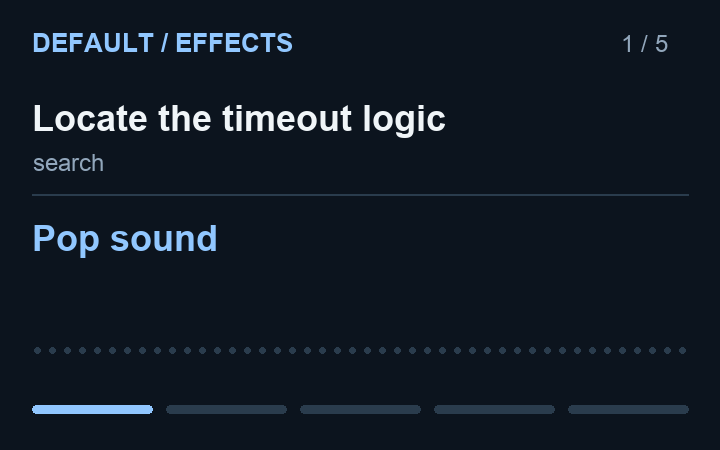
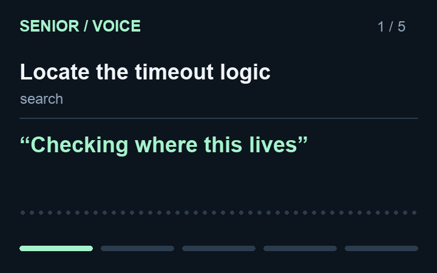
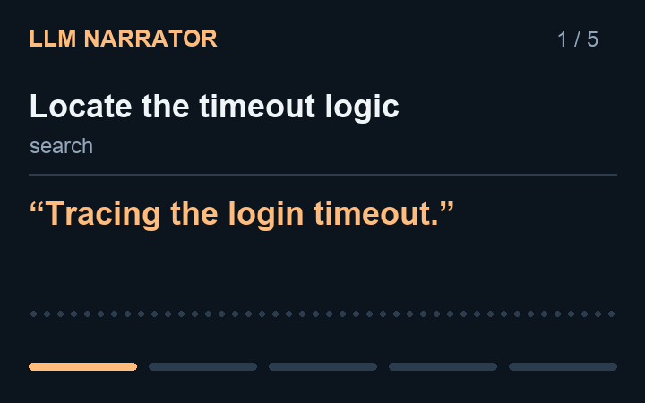

# Code Gossip

**Hear your agents work.** Code Gossip turns Claude Code, Codex, and Cursor events into sound effects, spoken cues, and live AI commentary.

| Sound effects · Default | Senior | LLM narrator |
| :---: | :---: | :---: |
| [](https://zorhay.github.io/code-gossip/#default) | [](https://zorhay.github.io/code-gossip/#senior) | [](https://zorhay.github.io/code-gossip/#narrator) |

**[▶ Open the demos with sound](https://zorhay.github.io/code-gossip/)** — press Play on the demo page; sound is enabled. The previews above are silent.

**Shared agent hooks · Soundbar · Effects, clips, phrases & AI commentary · Editable phrases · Optional AI narrator · macOS**

## Installation

### Install with your agent

> [!TIP]
> **Recommended: install with your agent.** Copy this prompt into **Codex, Claude Code, or Cursor** on your Mac:
>
> ```text
> Install https://github.com/zorhay/code-gossip for this agent.
> Follow the README and verify the installation.
> ```

**Upgrading from before 0.5.0?** The installation layout changed in 0.5.0, with no automatic migration. Follow the [upgrade steps](CHANGELOG.md#050---2026-10-11) before installing.

<details>
<summary><strong>Manual installation</strong></summary>

Requires macOS, Python 3, and jq. SoX enables generated effects.

```bash
brew install jq python
brew install sox          # optional

git clone https://github.com/zorhay/code-gossip.git
cd code-gossip
bash ./install.sh
```

Choose **all** detected agents, or multiple names/numbers such as `codex,cursor` or `2 3`. To skip the prompt:

```bash
bash ./install.sh --agents codex,claude
bash ./install.sh --all                  # every detected agent
bash ./install.sh --dry-run              # preview changes
```

For Codex, review and trust the commands in the CLI's `/hooks`, then start a new chat. Start a new session in your other selected agents too. Use the same `CODEX_HOME` when installing, updating, and removing a custom Codex setup.

Installation starts Soundbar in the background and opens it in your browser. Reinstallation restarts its existing panel to load updates. Use `--no-panel` for unattended installs or to configure it later.

Everything lives in `~/.code-gossip/`. The installer preserves settings and unrelated hooks; repeat installs do not duplicate integrations.

</details>

<details>
<summary><strong>Develop from a checkout</strong></summary>

```bash
bash ./install.sh --dev --agents codex,claude
```

This links `~/.code-gossip/` to the checkout's `code-gossip/` directory. Changes take effect directly; local preferences and runtime state stay gitignored. If a regular installation already exists, preserve any wanted settings, uninstall it, and remove the retained installation directory before switching to dev mode. Review new Codex hook commands in `/hooks`.

```bash
python3 -m pytest                         # full suite; requires pytest
python3 -m unittest tests.test_codex       # standard-library adapter tests
bash ./test-install.sh                    # validate the installed runtime
```

</details>

## Using Code Gossip

### Soundbar

Installation opens Soundbar automatically. To open it again:

```bash
~/.code-gossip/soundbar/panel.sh
```

At [localhost:8111](http://localhost:8111), browse **Effects**, **Clips**, **Phrases**, or **AI commentary**. Browsing, previews, and setup checks leave your active selection unchanged. Choose **Apply** to activate a mode or save edits. The active selection stays visible above the tabs. Sound on/off and volume control the active audio; **Settings** contains repeat gaps and Codex approval cues.

| Category | Controls | Setup |
|---|---|---|
| **Effects** | Sound pack, event, and sample preview | Checks bundled files; generated packs require SoX |
| **Clips** | Generals recorded responses | Checks the bundled collection |
| **Phrases** | Editable Senior phrases, main-agent and subagent voices | Built-in macOS speech or optional Kokoro |
| **AI commentary** | Style, voice, and session context | Provider, model, optional API key, connection check, and speech engine |

Previews play the selected event and alternative. Phrases also have per-row playback. AI commentary’s **Play sample** generates and plays a sample on the first click; replaying the displayed text does not make another AI request.

Each category has a **Setup** foldout; AI commentary separates provider and speech setup. Setup checks run automatically on load and relevant settings changes without saving drafts. Provider and speech checks are independent; colored results remain beside reusable check buttons. Model suggestions load from the provider, with a refresh control and manual entry (Claude CLI uses manual entry/default). Installation progress resumes when the panel reloads. Kokoro installs only when you click **Install Kokoro**. SoX setup shows the installation command to run in your terminal. Activation selects one mode and preserves mute. Existing combined Effects + Voice settings remain unchanged until you explicitly activate a mode; the CLI still supports independent channels.

**Settings → Close Soundbar** stops the panel server; closing the browser tab alone leaves it running. Hook audio continues either way. Topic tips appear in a translucent yellow-gold column at the top right. Click a topic to start its own guided scenario, or dismiss it individually. **?** hides the column or restores all tips; dismissals are remembered in that browser.

The narrator supports Claude CLI, Anthropic, Gemini, OpenAI, and Ollama. It sends event context to the selected provider, which may charge for usage. Cloud connection checks also make a small generation request, including automatic checks when AI commentary is selected. Fixed phrases and sound effects need no LLM.

### Commands

```bash
~/.code-gossip/switch.sh                          # status and available controls
~/.code-gossip/switch.sh voice-profile senior     # the demo's profile
~/.code-gossip/switch.sh voice on                 # enable spoken cues
~/.code-gossip/switch.sh effects-profile paper    # choose effects
~/.code-gossip/switch.sh effects off              # mute effects
~/.code-gossip/switch.sh voice off                # mute voice
```

To mute everything in Soundbar, turn **Sound off**. From the CLI, disable both channels. Saved preferences, phrases, and narrator styles live in `~/.code-gossip/configs/`; narrator API keys are stored in `config.json`.

<details>
<summary><strong>Update or uninstall</strong></summary>

From the checkout:

```bash
git pull
bash ./install.sh                      # use --dev for a dev installation
bash ./uninstall.sh                    # select integrations to remove
bash ./uninstall.sh --all              # remove all without questions
bash ./uninstall.sh --all --purge      # also remove saved settings
```

Partial removal keeps the runtime for remaining integrations. Dev removal only unlinks the installation; checkout files and settings remain even with `--purge`. Codex may require review of changed hooks in `/hooks` and a new chat after an update.

</details>

<details>
<summary><strong>No sound?</strong></summary>

Try a Soundbar preview first. Check Sound on/off, volume, and your output device. If previews work but agent events are silent, review the selected integration; for Codex, trust the hooks in `/hooks` and start a new chat. For narration, check the provider and speech engine separately in **Setup**, then **Play sample**.

```bash
bash ./test-install.sh
python3 ~/.code-gossip/engine/narrate.py --check-tts
bash ~/.code-gossip/data/sounds/generals/generate.sh  # regenerate missing clips
```

Only mapped events play. A completion cue means the current turn ended; it does not certify the whole task is complete.

</details>

[Architecture](ARCHITECTURE.md) · [Sound-design skill](dev-skills/sound-design/SKILL.md) · [Docs skill](dev-skills/maintain-docs/SKILL.md) · [Changelog](CHANGELOG.md)

Scripts: MIT. Bundled sampled audio: CC0. Default effects use macOS system sounds. Generals clips: generated with macOS speech. Demos use the shipped Default effects, AI-written narrator commentary, and Senior phrases; regenerate them with `python3 docs/render_demo.py` (Pillow, FFmpeg, and Kokoro installed in `code-gossip/state/.venv`; set `DEMO_KOKORO_PYTHON` for another location). The [demo page](https://zorhay.github.io/code-gossip/) serves these files directly through GitHub Pages; regenerated assets go live when a GitHub release containing them is published.
