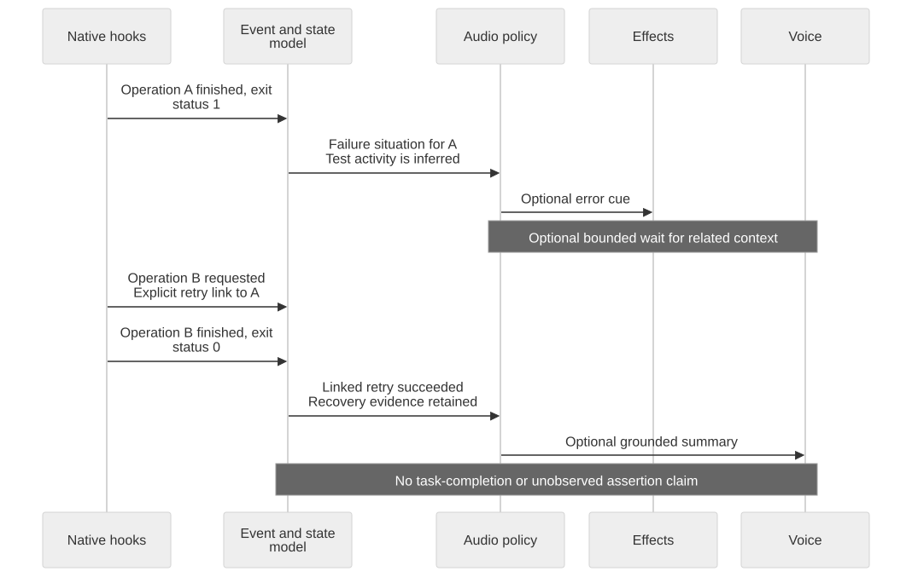

# Experimental event model for Code Gossip

**Status:** design draft E1, not implemented. **Date:** 28 October 2026. **Audience:** contributors designing hook adapters, state interpretation, and audio behavior.

Code Gossip should describe what happened before deciding what to play. This experiment introduces a shared event model for Codex, Claude Code, and Cursor, with separate dimensions for the affected entity, activity, lifecycle transition, outcome, actor, and evidence. An interpretation layer can then recognize useful situations without treating every hook as an instruction to make sound.

The existing 24 event names remain audio cue identifiers. They are a projection of the richer model, not its taxonomy. This preserves the shipped sound vocabulary while allowing the system to distinguish a failed test from a failed subagent, a response boundary from task completion, and a permission request from a denial.

This document specifies an experiment and its review criteria. The [current architecture](../../ARCHITECTURE.md) remains the reference for shipped behavior. No runtime changes, hook installation, settings changes, or release are part of this draft.

For product opportunities, see [Product directions](#10-product-directions). For the first concrete trial, see [Event inspector and intelligent audio director](#11-first-experiment-event-inspector-and-intelligent-audio-director).

## 1. Design decisions

| Decision | Consequence |
|---|---|
| Classify the subject by entity type | Session, turn, agent, operation, and interaction are peer categories |
| Describe activity separately | Git, testing, editing, and compaction belong to operations |
| Record outcome separately | Failure and cancellation retain the identity of the affected work |
| Preserve evidence and uncertainty | A missing result never becomes a successful result |
| Keep observation separate from interpretation | A heuristic may label activity, but cannot rewrite an observed exit status |
| Keep interpretation separate from audio | Several events may produce one cue, or no cue |
| Keep hooks observational and independent of Soundbar | The experiment must not change permissions, trust, or agent control flow |

E1 is deliberately local and deterministic. An LLM may later summarize established facts or help classify ambiguous activity, but it is not the authority for lifecycle transitions or successful outcomes.

## 2. System boundaries



[Editable diagram source](diagrams/event-pipeline.mmd)

| Stage | Owns | Does not own |
|---|---|---|
| Capture | Native hook identity, receive time, source IDs, selected payload fields | Sound selection or claims about task success |
| Adapter | Product-specific fields and documented lifecycle semantics | Shared command-purpose heuristics |
| Classifier | Activity labels and their evidence | Changing observed outcomes |
| State reducer | Correlation, lifecycle state, duplicates, incomplete observations | Narration or agent permissions |
| Interpreter | Derived situations supported by events and state | Inventing missing source events |
| Audio policy | Relevance, priority, grouping, expiry, and channel choice | Changing the underlying facts |
| Renderer | A cue, phrase, or grounded narration for Effects or Voice | Deciding whether the task is complete |

These are logical responsibilities, not a requirement for seven processes or services. A background worker can execute them together. Hook capture must return promptly, playback failures must remain isolated, and closing Soundbar must leave the hook path functional.

The existing [`play.sh`](../../code-gossip/engine/play.sh), [`playback_gate.py`](../../code-gossip/engine/playback_gate.py), and audio renderers are downstream integration points. The experiment does not replace audio assets or require a running panel server.

## 3. Entity taxonomy and independent dimensions



[Editable diagram source](diagrams/event-dimensions.mmd)

### Entity types

| Subject type | Identity and lifetime | Example transitions |
|---|---|---|
| `session` | A source conversation or session; preserve the source distinction | `opened`, `resumed`, `reset`, `closed` |
| `turn` | A request/response cycle within a session | `prompt_submitted`, `processing_started`, `response_ended`, `interrupted`, `failed` |
| `agent` | An executing main agent or subagent, with an optional parent | `spawned`, `response_ended`, `terminated` |
| `operation` | One invocation or causally identified unit of work | `requested`, `started`, `progressed`, `finished` |
| `interaction` | An approval or clarification exchange associated with work | `requested`, `resolved`, `withdrawn` |

Transitions are constrained by subject type. A generic phase such as “before” or “after” can be derived for display; it must not erase the precise boundary. In particular, `response_ended` does not assert that a turn cannot continue or that the user's task is complete.

`PreToolUse` establishes an attempted invocation: use `operation.requested`, not `operation.started`. Another hook or approval gate can still prevent execution. A native post-execution signal can establish a finished operation even when its start was not observed.

### Activity, tool, and outcome

Activities describe semantic work with a resource-oriented domain and an action. Tool identity describes the mechanism. Both can be retained without making one the parent category of the other.

| Domain | Actions illustrated in E1 | Possible mechanisms |
|---|---|---|
| `file` | `read`, `edit` | Native file tool, patch tool, shell |
| `information` | `search` | Grep, file search, a search MCP tool |
| `plan` | `update` | A planning tool |
| `test_suite` | `run` | A test runner invoked through a shell |
| `artifact` | `build` | A compiler or build runner |
| `repository` | `inspect_status`, `inspect_history`, `commit`, `push`, `other` | Git through a shell or a repository tool |
| `context` | `compact` | Native compaction lifecycle hooks |
| `unknown` | `unknown` | Any invocation not classified with sufficient evidence |

This is an initial activity vocabulary, not a claim that tool names completely determine intent. A shell call is an operation even when its activity is unknown. An MCP tool called `get_*` is not automatically a read-only operation. “Read-like” describes a classification hypothesis, not a security guarantee.

Outcome values are `unknown`, `succeeded`, `failed`, `cancelled`, and `denied`. They apply to the subject named in the event. An approval resolution may instead carry a decision of `approved` or `denied`; approval alone does not establish that the associated operation ran.

### Relationships



[Editable diagram source](diagrams/entity-relationships.mmd)

An agent is an actor, not a turn. A subagent can execute several operations and survive more than one response. Delegation consists of a parent/child actor relationship and observed lifecycle changes. A `SubagentStop` response boundary must not silently become proof that a reusable agent process was destroyed.

An operation can have child operations when the source exposes them. For a compound shell command without child identities or individual results, retain one compound operation. Do not manufacture a successful commit child from a command string containing `git commit`.

An interaction may block one operation while other operations continue. “Waiting for approval” and “doing work” can therefore coexist within a session.

## 4. Proposed event contract

The contract describes records, not an implementation language or storage format requirement. A versioned JSON envelope is suitable for fixtures, inspection, and replay.

| Field | Requirement and meaning |
|---|---|
| `schema_version` | Required; E1 uses `1` as an experimental schema version, not a product release |
| `event_id` | Required; unique identity for this captured observation |
| `received_at` | Required UTC timestamp assigned during capture |
| `occurred_at` | Source timestamp when provided; otherwise `null`, not a copy pretending to be source time |
| `source` | Product, native hook, optional client version/surface, source event ID, adapter version |
| `subject` | Entity type and ID; ID may be `null` when no reliable identity is available |
| `transition` | Required subject-specific lifecycle change or boundary |
| `activity` | Domain/action or unknown; normally applicable to operations |
| `outcome` | Value plus evidence supporting it; unknown when unestablished |
| `actor` | Agent identity, role, and parent identity where known |
| `context` | Session, turn, parent operation, and related interaction IDs where known |
| `tool` | Native name and family, independently of semantic activity |
| `facts` | Selected structured observations such as exit status, reason, failure type, or no-match result |
| `evidence` | Field-level provenance: observed, inferred, or unknown; inference rule/version and supporting fields |

An illustrative record for a shell command that ran a recognized test invocation:

```json
{
  "schema_version": 1,
  "event_id": "evt-example-42",
  "received_at": "2026-10-28T10:00:02Z",
  "occurred_at": null,
  "source": {
    "product": "codex",
    "hook": "PostToolUse",
    "adapter_version": "e1",
    "source_event_id": null
  },
  "subject": {"type": "operation", "id": "codex:session-example:call-example"},
  "transition": "finished",
  "activity": {"domain": "test_suite", "action": "run"},
  "outcome": {"value": "failed"},
  "actor": {"id": null, "role": "unknown", "parent_id": null},
  "context": {"session_id": "session-example", "turn_id": "turn-example"},
  "tool": {"name": "Bash", "family": "shell"},
  "facts": {"exit_code": 1},
  "evidence": {
    "subject.id": {"kind": "observed", "fields": ["session_id", "tool_use_id"]},
    "activity": {"kind": "inferred", "rule": "recognized-test-command/e1"},
    "outcome": {"kind": "observed", "fields": ["tool_response.exit_code"]}
  }
}
```

The record says the test invocation failed. It does not claim that a particular assertion failed: the runner may have failed to start. A richer test result requires additional structured evidence.

### Evidence rules

- Preserve native identity and the original hook name even after normalization.
- Keep observed facts immutable. New interpretations reference the facts and the interpreter version rather than overwriting history.
- Use field-level evidence. Observing an exit code does not make an inferred command purpose observed.
- Use `unknown` explicitly; absence is neither success nor failure.
- Avoid invented numeric confidence scores in E1. Use evidence kinds and explicit reasons that a reviewer can inspect.
- Record unsupported payload variants as coverage gaps. A malformed record should not become a generic successful tool event.

## 5. Native hooks and adapter responsibilities

The following tables cover the current subscriptions, reviewed against the public contracts on 28 October 2026. They specify proposed normalization, not complete live-delivery guarantees. Client versions and concrete payload fixtures must accompany implementation validation.

### Codex

| Native hook | Proposed subject and transition | Rule |
|---|---|---|
| `SessionStart` | Session opened/resumed/reset | Include fork source; preserve source; exclude compaction from startup cues |
| `SessionEnd` | Session closed | Preserve reason; no task-success inference |
| `UserPromptSubmit` | Turn prompt submitted | Processing has not yet been established |
| `Stop` | Turn response ended | A continuation remains possible |
| `Interrupt` | Turn interrupted | Outcome cancelled |
| `SubagentStart` | Agent spawned | Preserve agent and parent/session identities |
| `SubagentStop` | Agent response ended | Preserve identity; no invented success or termination |
| `PreCompact` | Context operation requested | Compaction may still be blocked |
| `PostCompact` | Context operation finished | Completion established; correlate conservatively |
| `PreToolUse` | Operation requested, or clarification interaction requested | Classify purpose separately; execution is not established |
| `PostToolUse` | Operation progressed/finished, or interaction resolved | Respect running results and explicit outcomes |
| `PermissionRequest` | Approval interaction requested | No approval decision output |

The [Codex hook reference](https://learn.chatgpt.com/docs/hooks) documents canonical shell hook identity as `Bash`, the `fork` source, and the three-second limit for session-end/interruption handlers. Apply that limit to both handlers. Hosted tools are outside some local hook paths; a quiet period is not proof that Codex is idle.

Clarification tools such as `request_user_input` are interactions. Their post-call result resolves the interaction only when the payload establishes an answer or cancellation. Scheduling an asynchronous question does not establish an answer; a tool-call receipt and the subsequent interaction have distinct identities.

### Claude Code

| Native hook | Proposed subject and transition | Rule |
|---|---|---|
| `SessionStart` | Session opened/resumed/reset | Exclude compact source; include fork |
| `UserPromptSubmit` | Turn prompt submitted | Preserve known prompt origin; do not assume every submission was manually typed |
| `Stop` | Turn response ended | Replace narration that asserts task completion |
| `StopFailure` | Turn failed | Preserve error type and available details |
| `PermissionRequest` | Approval interaction requested | No permission decision output |
| `PostCompact` | Context operation finished | Start may be unobserved |
| `SubagentStart` | Agent spawned | Preserve agent identity/type |
| `SubagentStop` | Agent response ended | Completion boundary, not proof of task success |
| `PreToolUse` | Operation requested | Current matchers: Edit/Write and Grep/Glob |
| `PostToolUse` | Operation finished | Current matcher: Bash |
| `PostToolUseFailure` | Operation finished | Cancelled for an explicit abort flag; otherwise failed |

Normalize `error` and optional `error_details` into shared error facts. The existing narrator's `error_message` assumption loses Claude details. The [Claude hook reference](https://code.claude.com/docs/en/hooks) distinguishes response endings, API failures, tool failures, and abort information. A reported abort is not a complete feed of every user cancellation.

Session-end and pre-compaction subscriptions are outside the current coverage. This draft records the gap rather than adding subscriptions implicitly.

### Cursor

| Native hook | Proposed subject and transition | Rule |
|---|---|---|
| `sessionStart` | Session opened | Preserve conversation/session identities |
| `sessionEnd` | Session closed | Preserve reason and final status |
| `afterFileEdit` | File-edit operation finished | Execution already occurred |
| `afterShellExecution` | Operation finished | Activity may be inferred; exit outcome remains unknown without evidence |
| `afterMCPExecution` | Operation finished | Retain tool identity and available result facts |
| `postToolUseFailure` | Operation finished | Cancellation first; otherwise preserve denial, timeout, or error |
| `subagentStop` | Agent response ended | Preserve completed/error/aborted status and subagent type |
| `preCompact` | Context operation about to start | Request boundary; no invented completion |
| `stop` | Turn response ended/interrupted/failed | Branch on the documented status; unknown status remains unknown |

The [Cursor hook reference](https://cursor.com/docs/hooks) supplies separate subagent outcomes and interruption/failure fields. Normalize `subagent_type` so the shared narrator retains it. Do not turn a failed or cancelled subagent into an ordinary success phrase. Generic tool hooks and some additional lifecycle hooks exist, but expanding subscriptions requires a separate coverage decision, especially where a hook participates in permission control.

### Corrections versus new coverage

E1 can correct payload interpretation within existing subscriptions. It can also inspect command purpose where a subscribed hook already provides the command. Neither action creates missing native events. Distinguish those changes from registering more hooks or enabling previously absent audible cues.

Each adapter should expose a capability description with four states: observed in a versioned fixture, documented but unobserved, available but unsubscribed, and unavailable/unknown. A capability belongs to a specific product, surface, version, and configuration; it is not a universal property of an agent brand.

## 6. Correlation and state



[Editable diagram source](diagrams/operation-state.mmd)

### Identity and ordering

1. Prefer source call IDs, agent IDs, session IDs, and turn IDs, namespaced by product and source session.
2. Keep capture event IDs separate from subject IDs. Retransmission is another delivery of an observation, not another operation.
3. Use a native event ID or an explicit adapter-specific delivery identity to deduplicate. A command string alone is not sufficient: repeated identical test runs are distinct operations.
4. A local subject ID may be minted when a start and its follow-up are causally linked. When that link is absent, retain an uncorrelated observation instead of guessing.
5. Source order, capture order, and causal order are different. Preserve timestamps and causal IDs; do not sort all agents into a fictional global execution order.

An adapter can record low-confidence correlation as a separate hypothesis. Such a hypothesis cannot justify success narration or dropping a potentially distinct error. If safe deduplication is impossible, the audio policy may suppress a repetitive cue while the event model keeps both observations.

### Incomplete observations

| Situation | Required behavior |
|---|---|
| Before-hook arrives, execution is later denied | Keep the attempted operation; record denial only when observed |
| Completion arrives without a start | Record a partial lifecycle ending; do not invent a start time |
| Start has no later result | Mark freshness stale/unknown after the observation window; do not invent cancellation |
| Result arrives after state expiry | Reconcile using stable source IDs where available; mark partial history |
| Duplicate final delivery | No duplicate transition or replayed cue when delivery identity proves duplication |
| Conflicting terminal outcomes | Retain both observations, expose a conflict, and suppress definitive narration until resolved |
| Parent turn ends with a live subagent | Preserve the subagent's independent state |
| One operation retries | Create a new operation identity; connect attempts only with explicit or separately marked inferred evidence |

For lifecycle updates, a late start must not reopen an already finished operation. Freshness is metadata about observation, not an operation outcome.

### Aggregate state

Session state is a collection, not one mutually exclusive label. It includes active operations, unresolved interactions, responding agents, recent outcomes, and observation gaps. A session can contain both running work and an unresolved approval request.

“Idle,” “recovered,” and “needs attention” are derived claims with supporting event IDs and an expiry. Silence or missing hooks alone cannot establish them. There is no authoritative task-completed state in E1 because the current hooks do not establish that the user's objective has been achieved.

## 7. Activity classification

The classifier receives normalized tool identity, selected input facts, and any result facts. It produces an activity label plus a rule/version and supporting evidence. Failure classification remains independent of activity classification.

| Case | E1 interpretation |
|---|---|
| Shell executes a recognized test runner | Operation activity `test_suite.run`; result is the invocation outcome |
| A command merely contains the word “test” | Insufficient evidence for test activity |
| Dependency installation | Preserve as an unclassified shell operation until an install activity is explicitly added; not a build |
| Read-only file inspection | `file.read` when supported by the invocation |
| In-place sed/awk or ambiguous scripting | Unknown activity unless mutation is reliably established; never assume read-only |
| Read-only search | `information.search`; recognized grep/rg no-match status is a normal result |
| Git status/history | Repository inspection, with result evidence preserved |
| Git commit/push preview or dry run | Repository activity marked preview; no saved-commit or pushed-change claim |
| Compound shell with one overall exit status | Outcome belongs to the compound invocation; child mutation success is unestablished |
| Tool name begins with `get_` or `write_` | Name-based activity hypothesis only; not proof of semantics |

Keep the full set of established activities for a compound operation when supported. A priority list may choose one audio cue, but must not erase the other activities from the event model.

## 8. Interpretation and audio decisions

An interpretation is a derived record containing a situation, subject references, supporting event IDs, interpreter version, and expiry. An audio decision separately contains channel actions, selected cue IDs, explanation codes, and supporting interpretation/event IDs.

Examples of situations include an unresolved approval request, an operation failure, an explicitly linked successful retry, and a subagent response becoming available. E1 uses deterministic rules. A later model can propose semantic labels or narration, subject to the same evidence boundary.



[Editable diagram source](diagrams/retry-sequence.mmd)

This scenario assumes explicit retry linkage is available. Where current hooks do not establish that relationship, keep independent attempts and avoid a definitive recovery claim.

### Audio policy

- Evaluate interruption and failure before ordinary work cues, while keeping the affected subject and actor.
- Effects and Voice have independent admission budgets. One channel can speak/play while the other stays quiet.
- Keep the existing no-backlog behavior for routine audio. Any aggregation window has a bounded expiry; expired candidates are discarded rather than spoken late.
- A failure may deserve an immediate effect while Voice waits briefly for related context. That wait is an optional policy experiment, not a change to event truth.
- An unresolved approval can merit attention even while unrelated work continues. Approval audio preferences still apply.
- Use a subagent voice or wording only when actor identity is established. Do not narrate a subagent abort as interruption of the whole turn.
- For response endings, use neutral response wording. Tests, builds, commits, and subagent returns do not become whole-task ending cues.
- If narration cannot be grounded, choose a neutral cue or silence. An LLM cannot upgrade an unknown outcome to success.

### Projection onto the 24 existing cue IDs

Projection is a policy decision, not a reverse conversion into a second source of event truth. Existing phrase/clip semantics must be audited before enabling a projection that would make a stronger claim than the evidence supports.

| Cue ID | Candidate facts or situation | Required guard |
|---|---|---|
| `session_start` | Session opened/resumed/reset | Exclude compaction restart; preserve fork origin |
| `session_end` | Session closed | Neutral ending, with reason retained |
| `user_prompt` | Turn prompt submitted | Do not imply processing has begun |
| `stop` | Turn response ended | Do not claim task completion |
| `interrupt` | Cancelled turn, agent response, or operation | Wording identifies the affected scope |
| `pre_compact` | Context compaction requested/about to begin | No completion claim |
| `compact` | Context compaction finished | Requires the native completion boundary |
| `subagent_start` | Child agent spawned | Known delegation relationship |
| `subagent_stop` | Child agent response ended | No failure/cancellation success phrase |
| `read` | Read activity | Wording respects before/after phase |
| `search` | Search activity | No-match is not automatically failure |
| `edit` | Edit activity | Requested edit is not a completed edit |
| `plan` | Plan-update operation | Clarification requests are interactions, not planning facts |
| `tool` | Other or unknown operation; optional neutral interaction cue | Do not invent semantic activity |
| `bash` | Unclassified shell operation | Tool family is known; purpose may be unknown |
| `test` | Test invocation | Do not claim all tests passed from invocation alone |
| `build` | Build invocation | Do not confuse installation or configuration with a completed build |
| `git_status` | Repository status inspection | Respect phase/outcome |
| `git_history` | Repository history inspection | Respect phase/outcome |
| `git_commit` | Established successful non-preview commit | Success attributable to the commit operation |
| `git_push` | Established successful non-preview push | Success attributable to the push operation |
| `git` | Other, preview, or uncertain repository operation | Neutral wording |
| `permission` | Unresolved approval interaction | Request is distinct from denial; obey audio preferences |
| `error` | Failed operation, agent response, or turn | Preserve details; do not replace cancellation with failure |

A denial remains `outcome=denied` even if the sound policy chooses an error-like cue. Clarification may use a neutral existing cue or remain quiet until content is designed for it. The richer model is not constrained to one cue per event.

## 9. Runtime and data boundaries

Use the package path helpers for all runtime locations and the configured Python executable. Proposed experimental records belong under local gitignored `state/`, never in shipped configuration or repository documentation fixtures containing personal content.

The capture path must preserve the existing background behavior. The experiment must not add a trailing background operator to installed hook commands, write hook decisions, alter agent permissions/trust, or require the Soundbar server. No extra approval-granting hooks are introduced for the sake of coverage symmetry.

E1 can use a bounded local event journal and compact state snapshots with a short lock. Lock failure, storage exhaustion, or malformed data should record a coverage gap when possible and fail quietly. They must not block agent work. In an audio-enabled experiment, failures must not dispatch both experimental and current audio paths for the same invocation.

Proposed starting limits for review are 10 MiB or 24 hours for metadata traces, whichever is reached first, with raw prompts, tool output, file contents, and credentials excluded by default. In-memory and persisted state must have explicit size and freshness limits. These are experimental settings to benchmark, not existing defaults.

Preserve tool IDs, bounded status facts, and evidence references sufficient for replay. Detailed payload collection requires a separate deliberate diagnostic mode and local handling. Recording metadata must not automatically send it to an LLM. Existing narrator-provider boundaries remain relevant when narration is selected.

## 10. Product directions

The event model can support a companion that explains ongoing work and directs attention. Audio is one output of that understanding. These are candidate directions, not commitments to implement every feature in E1.

| Capability | Useful behavior | Evidence boundary and scope |
|---|---|---|
| Intelligent audio director | Group routine work, prioritize meaningful changes, and discard stale commentary | Uses event/state evidence and independent channel budgets; first experiment |
| Event inspector and replay | Explain why a cue played or remained silent; compare policies on the same sequence | Read-only event, interpretation, and decision views; first experiment |
| Contextual narration | Explain changes across several operations rather than narrating each call | State temporal relationships directly; causal explanations require evidence; begin with deterministic templates |
| Attention tracker | Surface unresolved approvals or clarification requests while showing other work continuing | Missing resolution signals leave an interaction unresolved or unknown; do not infer an answer |
| Live activity view | Show sessions, agents, operations, and their parent/child relationships | Distinguish observed activity from partial or stale observations |
| Session recap | Summarize observed edits, command outcomes, agent responses, and unresolved interactions | Describe only the retained observation window; flag coverage gaps and avoid task-completion claims |
| Personal audio preferences | Adapt which situations receive sound or speech, and how often | Start with explicit preferences and feedback; any learned preference is inspectable and reversible |

Sequences make these features more useful. A failed operation followed by file reads can produce a brief account of the change in activity. An explicitly linked successful retry can update an earlier failure narrative. Parallel agent responses can be grouped while individual failures remain visible. Interruption invalidates pending commentary for the cancelled work. A long-running update requires a fresh running/progress signal; silence alone establishes neither continued execution nor a stall.

Some directions require inputs beyond the hook stream:

| Capability | Additional input | Claim enabled by that input |
|---|---|---|
| Task-progress tracking | An explicit task model, milestones, and completion criteria | Progress against a defined objective rather than a count of tool calls |
| Verification summaries | Structured test/build reports | Assertion counts, failed checks, or produced artifacts rather than an invocation exit status alone |
| Change explanations | Diffs and repository context | What changed and where, with separately qualified explanations of intent |
| Recovery suggestions | Relevant diagnostics, environment facts, and known remedies | Grounded suggestions; execution remains a separate authorized action |
| Time estimates | Comparable historical runs and reliable lifecycle timing | An estimate with a visible basis and uncertainty; abstain when examples are insufficient |

The proposed order is inspector plus director, then contextual narration, then broader attention/activity views and recaps. Personalization and features requiring additional inputs should follow evidence that the base model and policy are useful. E1 does not autonomously repair code, approve operations, or learn preferences from silence.

## 11. First experiment Event inspector and intelligent audio director

### Question and hypothesis

Can a policy that understands an event sequence communicate the important changes with less repetition than the current audio path, while preserving factual accuracy and making every decision explainable?

The primary scenario is **edit → test invocation fails → file inspection → retry → response ends**. The inspector and director are evaluated together: the director chooses useful audio, and the inspector exposes the observations and rules behind each choice. A policy that sounds quieter but hides a failure does not pass.

This trial implements the offline-replay stage described in [Experiment stages and acceptance](#12-experiment-stages-and-acceptance). Shadow observation and live audio remain later gates. The deliverable specified here is an experimental design; the inspector, director, fixtures, and controls are not implemented by this document.

### Scope and comparison

Use a frozen, sanitized native-hook fixture as input to two isolated paths. The baseline runs the current adapters, cue projection, and playback spacing. The candidate runs the proposed normalization, state interpretation, and deterministic director. Both retain the same received-event timeline, selected profile, channel preferences, volume, audio variants, and renderer. The current baseline already suppresses some audio; it must not be replaced with an artificial “play every hook” baseline.

Pin source revision, adapter/classifier/policy versions, fixture provenance, settings, and selected sample variants in a trial manifest. Use a virtual clock for deterministic replay, including deferred decisions and expiry. A comparison never executes captured tools, replays approvals, calls an LLM, or writes personal settings. Listening, when requested, enables one lane at a time and keeps simulated timing intact.

Choose a shipped effects pack and a fixed-phrase Voice baseline for this first comparison. Candidate contextual wording uses reviewed, frozen templates through the same speech engine and voice. Identical cue selections use identical sample variants. The comparison evaluates policy and grounded wording; variability from live LLM narration is outside this trial.

Start with synthetic Codex-shaped fixtures, clearly labelled synthetic. They exercise the contract without claiming live coverage. For Claude and Cursor, use capability-adjusted variants with only fields and boundaries their subscribed hooks can establish. For example, a Cursor shell completion without an exit status remains unknown even when the synthetic scenario author knows the command succeeded. A successful result and a retry relationship must not be inserted into a native fixture merely to make the story complete.



[Editable diagram source](diagrams/inspector-experiment.mmd)

### Representative scenario

Times below are illustrative replay offsets. Each operation has its own identity; the inspection burst contains ten distinct read operations. The primary native-hook comparison supplies only source-supported terminal outcomes and does not assume a retry relationship. A separate model/policy fixture supplies an explicit link to test recovery behavior; its results are reported separately from native-source coverage. “Retry” describes the scenario author's intent until that link is established.

| Replay point | Established observations | Inspector should show | Candidate response intent |
|---|---|---|---|
| 0–1 s | An edit is requested, then completes | Requested and finished boundaries for one operation | At most one ordinary edit effect; no completed-edit claim at the request boundary |
| 1–3 s | Test operation A is requested and returns exit status 1 | Test purpose inferred from invocation; failure outcome supported by the result | Select an error effect promptly; allow a short bounded wait for Voice context |
| 3–5 s | Ten file-read operations follow | Every operation retained; temporal sequence does not prove those reads were intended to fix A | At most one inspection effect for the burst; no per-read narration |
| 5 s | The bounded Voice window ends | Decision references A and the observed completed reads | At most one failure/context utterance; do not invent a failing assertion or root cause |
| 6–9 s | Operation B is requested and later returns exit status 0 | B remains distinct from A; the primary comparison has no established retry link | An ordinary test-result effect or neutral result update may be selected; recovery wording is limited to the linked model fixture |
| 10 s | The agent's response ends | Response boundary, with remaining work/interactions still visible | A neutral turn-ending cue; no “task complete” statement |

Illustrative grounded wording is “The test command failed. Several file reads followed.” With the explicit relationship and exit result, a later update may say “The linked retry command succeeded.” These examples describe admissible meaning, not new shipped phrases or recordings. Without the link, describe B independently or remain quiet; do not say the earlier failure was resolved.

### Inspector views and controls

The inspector is a local, read-only review surface. It can be displayed through Soundbar later, but neither event processing nor hook audio depends on that surface being open.

| View | Contents | Question it answers |
|---|---|---|
| Timeline | Received time, optional source time, source hook, subject ID, activity, transition, outcome, evidence kind | What was actually observed, and in what order? |
| Observation details | Selected sanitized payload facts, normalized fields, rule versions, source/correlation IDs, and unknown fields | Which fields support this interpretation? |
| State at the cursor | Agents, operations, unresolved interactions, freshness, partial lifecycles, and conflicts | What could the system know at this moment? |
| Policy comparison | Baseline and candidate Effects/Voice decisions aligned to the same virtual clock | What changed, and why? |
| Decision details | Supporting events/state, rule, cue or template, channel action, budget result, deadline, and supersession reason | Why was this cue selected, suppressed, replaced, or expired? |
| Playback outcome | Selected, admitted, dispatch attempted, playback started/finished where acknowledged, or outcome unknown | Did a decision actually produce sound? |

Controls should cover fixture and policy selection, filtering by actor/subject/outcome, stepping to the next observation or decision deadline, seeking to a timestamp, and restarting replay from an empty isolated state. A separate explicit listening control selects one comparison lane. Filtering the view does not remove events from the reducer. Seeking reconstructs state from the fixture; it does not mutate history or retrigger native actions. Replay produces a new versioned decision trace, leaving the original trace intact.

Every candidate decision, including silence, needs an ID; supporting event/interpretation IDs; subject scope; policy/settings version; channel action; reason; and any expiry or replaced-decision ID. Explanations should be readable, such as “Same inspection burst,” “Voice disabled,” “Outcome unknown,” “Superseded by linked recovery,” or “Expired before playback.” A selected cue is not labelled played without playback evidence. For offline analysis, report what would be admitted separately from actual listening results.

### First candidate policy

Keep policy rules deterministic and freeze them before a comparison. The following values are starting parameters for this experiment, not changes to shipped defaults. The normal channel budgets remain applicable after semantic selection.

| Situation | Effects decision | Voice decision | Boundary |
|---|---|---|---|
| Routine editing/inspection | First relevant cue, then at most one routine cue per 2-second window for the same session, turn, and actor | No per-operation narration | Group decisions, never erase observations; normal global/channel budgets can suppress further |
| Explicit operation failure | Select an error cue without semantic delay | One context candidate eligible after 2 seconds | Gather only observed context; expires 5 seconds after the original failure if not dispatched |
| Later successful test invocation without retry linkage | An ordinary result cue may be selected | At most one independent result update, if useful after the failure message | Name B's result without claiming that A was repaired; proposed expiry 3 seconds after B's result |
| Explicitly linked recovery | An ordinary result cue may be selected | Replace an unsent failure candidate, or create one brief update if it was already spoken | Require established retry linkage and attributable success; never infer all tests passed |
| New approval request | Select the preference-enabled attention cue promptly | An eligible approval message takes priority over pending routine commentary | Do not delay it for the failure-context window or manufacture approval resolution |
| Cancellation | Select a scope-appropriate interruption cue | Cancel unsent candidates for the affected work | Other agents' pending work is unaffected |
| Response boundary | Select a neutral turn-ending cue | No additional completion speech by default | Pending operation facts and unresolved interactions remain in state |
| Unknown, conflicting, or stale result | Neutral activity cue or silence | Abstain from definitive result claims | State and inspector still expose the uncertainty |

Pending Voice context is bounded aggregation, not a FIFO narration queue. An equivalent failure candidate is not renewed by duplicate deliveries or routine reads. Any replacement inherits the original deadline; a distinct recovery update has its own deadline, proposed as 3 seconds after the recovery observation. Pending candidates invalidated by cancellation or known supersession are discarded before dispatch. A response boundary closes the ordinary commentary context for that actor; it does not cancel independent child-agent commentary or resolve approval requests. This changes audio eligibility, not retained facts or unresolved failure state. If the channel budget cannot admit a candidate before expiry, drop it and record why.

Keep pending contexts separate by subject and actor, with a proposed global cap of eight for the offline stress case. When the cap is reached, discard the lowest-priority context candidate with an explanation rather than growing a backlog; approval selection remains immediate and facts remain intact. Recheck validity immediately before playback. The initial experiment does not interrupt a clip already playing: it prevents stale future dispatch and measures speech that began validly but became outdated during playback separately.

One playback owner applies per mode: offline comparison is silent by default; shadow mode lets only the current path play; a later candidate audio trial lets only the candidate path play. Policy or renderer failure must not cause both lanes to dispatch.

### Procedure and review

1. Freeze the manifest and fixture, label synthetic versus captured evidence, and annotate expected knowledge at each checkpoint before inspecting candidate results.
2. Replay both policies without audio using the same clock and selected assets. Inspect state transitions and decision reasons, including silence and timer-driven decisions.
3. Exercise the primary unlinked sequence, the separately labelled linked model fixture, and variants with unknown exit status, duplicate/out-of-order results, cancellation before the Voice deadline, an approval during inspection, and a second actor with the same command.
4. Review the event inspector for false correlation, unsupported claims, lost observations, and unexplained audio differences. Fix correctness problems before listening.
5. Listen to each lane separately in alternating order, with the same output settings. At the failure, follow-up, and response boundary, ask the reviewer what changed, what needs attention, and what remains unknown. Record useful, repetitive, distracting, and misleading moments against decision IDs.
6. Compare results against the criteria below. Change one policy parameter at a time, version the new run, and repeat only the affected comparisons. A favourable synthetic replay permits a shadow trial, not immediate general rollout.

### Measures and acceptance for this experiment

| Measure | Evidence | Acceptance or interpretation |
|---|---|---|
| Factual accuracy | Every spoken claim traced to facts and qualified inferences | Zero unsupported success, causal-recovery, root-cause, or task-completion claims |
| State integrity | Replay checkpoints and operation identities | No merging identical independent commands; no loss of uncertainty or unresolved interactions |
| Explainability | Decision details, including suppression and expiry | Every candidate decision has scope, evidence references, rule/version, and a reason |
| Determinism | Repeat replay with identical manifest and virtual clock | Same normalized state and decisions apart from run identifiers |
| Important changes | Eligible failure/approval decisions in the enabled-channel fixture | No semantic suppression of the first relevant failure or approval as routine noise; renderer/budget failures reported separately |
| Repetition | Selected, admitted, and actually started cues counted separately per channel | No duplicate cue for proven duplicate delivery; fewer routine interruptions than baseline when baseline has repetition |
| Main-sequence speech | Voice decisions and measured listening duration | At most two contextual utterances: failure/context and an evidence-backed result update; no required minimum |
| Freshness | Candidate deadlines, cancellation, and dispatch times | No candidate dispatched after expiry or known invalidation; speech already in progress measured separately |
| User understanding | Reviewer answers at fixed checkpoints | No loss of understanding of the failure, subsequent result, or unresolved uncertainty relative to baseline |
| Runtime boundaries | Later shadow-mode timing/storage checks | No agent control-flow change, duplicate playback ownership, unbounded storage, or panel dependency |

Report counts and timing rather than assuming fewer events automatically means better audio. If the baseline is already quiet, equal cue counts with clearer, better-grounded communication can be a useful result. Report synthetic replay, human listening, and live shadow results separately; none substitutes for the others.

The review package should contain the versioned fixture manifest, expected checkpoint states, both decision traces, a summary of cue counts and speech duration, reviewer observations, and a go/revise/stop decision for shadow observation. Failed invariants block progression even if the candidate is preferred in listening. A live audio trial requires the separate stage-D review below.

## 12. Experiment stages and acceptance

| Stage | Deliverable | Audio behavior | Exit criteria |
|---|---|---|---|
| A. Contract fixtures | Sanitized examples and expected records for each subscribed hook | Current behavior only | Every adapter rule has evidence; unknown variants remain explicit |
| B. Offline replay | Reducer and deterministic interpretation exercised against fixtures | Simulated decisions; explicit offline listening | Lifecycle/correlation invariants hold across failure and ordering cases |
| C. Shadow observation | Opt-in local normalization and decision trace alongside current audio | Only current path plays | No duplicate playback; bounded cost; meaningful decision explanations |
| D. Limited audio trial | Opt-in experimental policy for a small scenario set | Exactly one policy owns playback | Better relevance without false success or stale narration |
| E. Intelligence trial | Grounded summaries or assisted activity classification | Existing evidence guards still apply | Models cannot alter facts or bypass deterministic guards |

Leaving an experiment disables its new processing and returns ownership to the current path. This is a controlled feature choice, not automatic settings migration or legacy-path support. Flag names, storage filenames, and release packaging remain implementation decisions.

### Required replay scenarios

| Scenario | Acceptance condition |
|---|---|
| Edit requested, then blocked | No “file edited” claim |
| Completion without start | Partial lifecycle retained |
| Duplicate completion | One state transition and at most one admitted cue when identity proves duplication |
| Identical command run twice | Two operations retained |
| Out-of-order start and result | Finished state does not reopen |
| Missing result | Stale/unknown, not successful or cancelled |
| Conflicting results | Conflict visible; definitive narration suppressed |
| Shell execution still running | No completion cue |
| Compound command masks a failing commit | No saved-commit cue |
| Search returns no matches | Normal search result |
| Failed test runner cannot start | No invented assertion failure |
| Cancelled subagent while parent continues | Cancellation stays scoped to that subagent |
| Parent response ends with active child | Child state retained; no whole-task completion claim |
| Approval pending alongside active work | Both states coexist |
| Asynchronous question dispatched without an answer | Interaction remains unresolved/unknown as appropriate |
| Compaction plus session-start hook | One compaction narrative, no false new-session cue |
| Recovered retry with explicit linkage | Recovery refers to the correct attempt chain |
| Retry relationship merely guessed | No definitive recovery claim |
| Panel closed or event storage unavailable | Agent work and independent hook audio remain functional |

### Evaluation measures

Track false success claims, duplicate cues, stale cues, dropped/unhandled observations, ambiguous correlations, and the proportion of audio decisions with an inspectable reason. Measure capture latency, background processing cost, state/journal size, and lock contention separately.

The safety gates for promotion are zero false-success claims in the acceptance corpus, no permission/control-flow changes, and no duplicate ownership of audio. Relevance and verbosity require human review against representative editing, testing, delegation, approval, and interruption sessions. Set performance thresholds after baseline measurement on supported installations, within every native hook deadline.

## 13. Open design decisions

1. Which additional subscriptions are valuable enough to justify broader coverage, particularly Cursor permission-participating hooks?
2. Which activities should be explicit in E1 beyond the current vocabulary, such as installation, deployment, or linting?
3. Which existing phrases and clips make claims stronger than response/operation evidence, and need revised wording or restricted projection?
4. Does the first experiment's bounded Voice window improve understanding, and which timing values survive shadow observation?
5. Which unresolved-interaction signals can each product actually supply, especially for asynchronous questions?
6. What event retention and performance budgets work on real normal and development installs?

These questions do not block review of the core separation: entity, activity, transition, outcome, and evidence are distinct; state is derived from observations; audio is selected by a separate policy.

## 14. Source and drawing notes

Current implementation anchors: [Codex adapter](../../code-gossip/hooks/codex.py), [Claude registrations](../../code-gossip/hooks/claude-hooks.json), [Cursor adapter](../../code-gossip/hooks/cursor.py), [cue catalog](../../code-gossip/soundbar/catalog.py), [narration context](../../code-gossip/engine/narrate.py), and [playback gate](../../code-gossip/engine/playback_gate.py).

Public hook contracts: [Codex](https://learn.chatgpt.com/docs/hooks), [Claude Code](https://code.claude.com/docs/en/hooks), and [Cursor](https://cursor.com/docs/hooks). Documentation establishes contracts; versioned fixtures and live observation establish actual delivery coverage.

Each drawing has editable Mermaid source beside its SVG export in [diagrams](diagrams/). The SVGs make the design readable in Markdown viewers without Mermaid support. Exported drawings use Mermaid 12.2.0 with the checked-in [render configuration](diagrams/mermaid-config.json); source files are the primary editable representation. Layout and link checks apply to the document and all six drawings.
